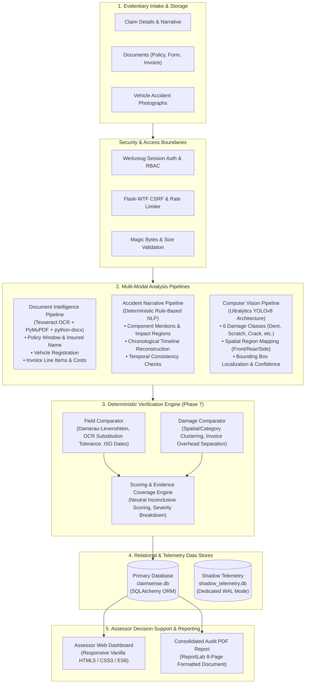
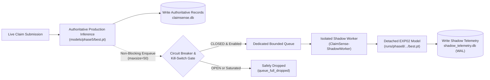

# ClaimSense AI

> **Explainable AI-Assisted Vehicle Insurance Claim Verification & Evidence Cross-Referencing Platform**
> *Academic Decision-Support Prototype &mdash; Final-Year B.Tech Major Project (Session 2026–2027)*

[](https://www.python.org/)
[-black?logo=flask)](https://flask.palletsprojects.com/)
[](https://www.sqlalchemy.org/)
[](https://www.sqlite.org/)
[](https://github.com/ultralytics/ultralytics)
[](https://pytorch.org/)
[-brightgreen)](tests/)
[](#-project-roadmap)

---

> [!IMPORTANT]
> **Academic Scope & Responsible AI Disclaimer:**
> ClaimSense AI is engineered strictly as an **assistive decision-support prototype** for insurance claims examiners and technical evaluators. It assists human assessors by cross-referencing multi-source evidentiary artifacts (official policy schedules, claim submission forms, repair invoices, claimant accident narratives, and vehicle photographs).
> **ClaimSense AI does NOT autonomously approve, adjust, or deny claims, nor does it assert legal proof of insurance fraud.** All algorithmic findings, damage classifications, and consistency scores require human assessor review and validation.

---

## 👥 Project Team & Academic Governance

* **Institution:** ABES Engineering College, Ghaziabad
* **Department:** Department of Computer Science & Engineering
* **Academic Session:** 2026–2027
* **Faculty Supervisor:** Ms. Sonia Lamba, Assistant Professor, Department of CSE

**Project Contributors:**
1. **Ansh Gupta** &mdash; Roll No. 2300320120051
2. **Ankit Yadav** &mdash; Roll No. 2300320120048
3. **Ananya Chauhan** &mdash; Roll No. 2300320120041

---

## 📌 Project Overview

Motor vehicle insurance claim adjudication routinely requires reconciling disparate, heterogeneous, and often contradictory sources of evidence:
* **Structured Policy Records:** Policy validity windows, insured vehicle registration numbers, coverage terms, and named beneficiaries.
* **Intake Claim Forms:** First-party loss descriptions, claimed incident timestamps, location statements, and driver declarations.
* **Repair Shop Documentation:** Garage work estimates, repair invoices, replacement part descriptions, and labor line items.
* **Claimant Accident Narratives:** Free-text descriptions detailing sequence of events, points of physical impact, and claimed damages.
* **Photographic Evidence:** High-resolution vehicle photographs depicting physical impact, paint scratches, dents, and fractures.

In traditional workflows, manual cross-referencing across these silos is labor-intensive, error-prone, and susceptible to cognitive fatigue. Relying on a single automated model (such as an isolated damage classifier or a single OCR tool) introduces severe brittleness: an algorithm cannot discern whether a detected dent existed before the collision or whether a repair shop billed for a bumper that the photograph proves is completely undamaged.

**ClaimSense AI** solves this challenge through an **evidence cross-referencing architecture**. Rather than trusting any single model, ClaimSense AI independently parses documents, detects visual vehicle damage via Computer Vision, reconstructs accident timelines via rule-based NLP, and submits all extracted entities to a **deterministic Cross-Source Verification Engine**. The system generates transparent, explainable consistency scores, highlights discrepancies, and compiles comprehensive audit reports for human claim assessors.

---

## 🏛️ System Architecture



---

## 🚀 Key Feature Modules

### 1. Claim Management & Evidentiary Intake
* **Secure Submission Workflow:** Ingests claimant metadata alongside 4 required evidentiary files: policy document, claim form, repair invoice, and primary vehicle photograph.
* **Deterministic File Validation:** Enforces MIME-type inspection, binary magic-byte verification (`%PDF-`, `\xFF\xD8\xFF`, `\x89PNG`, `PK\x03\x04`), 0-byte upload rejection, and 16 MB request limits.
* **Structured Claim Identification:** Automatically generates tamper-resistant, chronological identifiers (`CLM-YYYYMMDD-XXXX`).
* **Lifecycle State Tracking:** Manages formal claim lifecycle states (`SUBMITTED`, `IN_REVIEW`, `VERIFIED`, `FLAGGED`) with ownership isolation.

### 2. Document Intelligence & OCR Pipeline
* **Multi-Format Parsing:** Ingests native vector PDFs, scanned PDF documents, Microsoft Word documents (`.docx`), and raster images (`.jpg`, `.png`).
* **OCR Preprocessing & Extraction:** Employs Tesseract OCR alongside PyMuPDF (`fitz`), Pillow, and OpenCV image binarization for low-contrast text.
* **Structured Field Provenance:** Extracts and retains provenance metadata for key policyholder attributes:
  * Insured party name and policy number
  * Policy validity coverage window (`start_date` to `end_date`)
  * Vehicle registration plate number
  * Repair invoice line items, component replacement costs, and total repair expenses
* **Document Validation:** Verifies structural document completeness and logs OCR confidence indicators.

### 3. Computer Vision Vehicle Damage Detection
* **YOLO-Based Object Detection:** Employs an Ultralytics YOLOv8 architecture optimized for automotive defect localization.
* **Six Fine-Grained Damage Categories:**
  1. `dent` &mdash; Surface indentations and body panel concavities.
  2. `scratch` &mdash; Linear abrasions and surface paint scuffs.
  3. `crack` &mdash; Hairline fractures and structural splits in plastic/metal bumpers.
  4. `glass shatter` &mdash; Fractured windshields, windows, and light clusters.
  5. `lamp broken` &mdash; Cracked or shattered headlamps, tail lamps, and indicator assemblies.
  6. `tire flat` &mdash; Punctured, deflated, or detached tires and wheels.
* **Spatial Damage Localization:** Bounding boxes are dynamically mapped to vehicle coordinate zones (`front_left`, `front_right`, `center`, `rear_left`, `rear_right`, `roof`, etc.) to facilitate spatial cross-checking.
* **Evidence Visualization:** Renders high-resolution annotated damage overlays with confidence badges and bounding-box coordinates.
* **Phase 9.20 Per-Class Threshold Support (Opt-In):** `VehicleDamageDetector._resolve_conf_thresholds()` and `POST /api/claims/<claim_id>/analyze-damage` support both legacy scalar `conf_threshold` (default `0.15`, `iou_threshold=0.45`) and opt-in per-class dictionaries (e.g., `{"dent": 0.18, "scratch": 0.28}`), rejecting booleans, out-of-range values, and unknown classes with `HTTP 400`. `models/phase5/best.pt` remains the sole active production checkpoint (`EXP20-01`–`06` were not promoted); **Phase 9.21 remains ON HOLD**.

### 4. Accident Narrative & Chronological Analysis (NLP)
* **Deterministic Rule-Based NLP:** Extracts entities, physical actions, and vehicle parts from claimant statements without unconstrained generative hallucination.
* **Impact & Damage Extraction:** Identifies claimed points of impact (e.g., "rear-ended at a traffic signal", "left side swiped") and affected components.
* **Chronological Sequence Reconstruction:** Reconstructs the temporal sequence of reported events:
  * Pre-incident travel &rarr; Collision/Impact &rarr; Post-collision actions &rarr; Claim filing.
* **Temporal Consistency Checks:** Flags anomalies such as delayed claim reporting, accident dates preceding policy inception, or post-dated incidents.
* *Scientific Disclosure:* The NLP pipeline is purely rule-based and pattern-driven; it was not trained as a supervised deep-learning NLP model.

### 5. Cross-Source Verification Engine (Phase 7)
The Phase 7 verification engine cross-examines evidence across all upstream modules:
* **Claim vs. Policy:** Verifies claimant identity, policy number, and vehicle registration using string distance algorithms (Damerau-Levenshtein transposition distance) and OCR substitution tables (`0`/`O`, `1`/`I`).
* **Policy Validity vs. Incident Date:** Confirms that the accident timestamp occurred strictly within the active policy validity window.
* **Narrative vs. Computer Vision:** Corroborates damages reported in the claimant's statement against bounding boxes detected by YOLOv8. Applies spatial region clustering and requires a confirmation threshold ($\ge 0.50$ confidence) to declare a visual match.
* **Invoice vs. Damage:** Differentiates genuine physical component replacements from standard workshop labor, paint, and administration overhead.
* **Standardized Finding Classifications:**
  * `MATCH`: Independent evidence sources corroborate the fact.
  * `MISMATCH`: Direct contradiction between evidentiary sources (e.g., mismatched registration plate).
  * `INCONCLUSIVE`: Insufficient or low-confidence evidence to confirm or refute a statement.
  * `NOT_VISUALLY_CONFIRMED`: A reported damage item lacks corresponding bounding-box detections in the photograph.
  * `VISUAL_ONLY_FINDING`: Significant physical vehicle damage detected in the photograph that was omitted from the claimant narrative.
  * `POTENTIAL_DISCREPANCY`: Minor date or nomenclature variances requiring manual review.
* **Evidence Coverage & Consistency Scoring:**
  $$\text{evidence\_coverage\_percentage} = \frac{\text{evaluated\_with\_data}}{\text{total\_comparisons}} \times 100.0$$
  The scoring engine assigns non-punitive neutral weights to inconclusive findings and calculates an overall status:
  * `CONSISTENT`: High cross-source corroboration with no critical mismatches.
  * `REVIEW_REQUIRED`: Unexplained visual damage clusters, uncorroborated parts, or moderate discrepancies.
  * `INSUFFICIENT_EVIDENCE`: Evidentiary coverage is too sparse to perform reliable cross-referencing.

#### Verified Verification API Endpoints
| HTTP Method | Endpoint Route | Description | Auth Required |
|:---:|:---|:---|:---:|
| `POST` | `/api/claims/<claim_id>/verify-cross-source` | Executes deterministic cross-source verification and persists findings | **Yes** |
| `GET` | `/api/claims/<claim_id>/verification` | Retrieves latest verification run, overall status, and consistency score | **Yes** |
| `GET` | `/api/claims/<claim_id>/verification/findings` | Fetches itemized comparison findings with severity ratings and evidence sources | **Yes** |
| `GET` | `/api/claims/<claim_id>/verification/summary` | Returns aggregated metrics, evidence coverage, and assessor recommendations | **Yes** |

### 6. Consolidated PDF Audit Report
* **8-Page Formatted Document:** Rendered via ReportLab with corporate headers, itemized evidence logs, tabular OCR entity summaries, visual damage crops with localized bounding boxes, NLP chronology tables, and Page 7 Cross-Source Verification audit summaries.
* **Official Intake Receipt:** Generates standalone, digitally formatted PDF receipts confirming intake timestamp and SHA-256 hashes of submitted files.

### 7. Assessor Web Dashboard & Frontend Capabilities
* **Responsive Single-Page Application (SPA):** Modern vanilla HTML5/CSS3/ES6 responsive dashboard designed for desktop monitors, tablets, and field mobile devices.
* **Intake & Claim Submission Wizard:** Step-by-step submission modal guiding users through claimant metadata entry, file selection (policy document, claim form, repair invoice, vehicle photograph), and immediate client/server validation.
* **Real-Time Policy Lookup:** Integrated policy lookup tab querying insured details, coverage validity windows, and registration match pre-validation.
* **Claim History & Lifecycle Tracking:** Tabular claim ledger presenting chronological claim records with filterable lifecycle status badges (`SUBMITTED`, `IN_REVIEW`, `VERIFIED`, `FLAGGED`) and strict user ownership isolation.
* **Bilingual Localization (English / Hindi):** Interactive top-bar language switcher dynamically translating all UI labels, form controls, validation warnings, and status descriptions between English and Hindi (हिन्दी).
* **Evidence Image Replacement & Re-Analysis Workflow:** Interactive replacement modal allowing assessors to upload supplemental or higher-resolution damage photographs, triggering automatic re-analysis, history logging, and visual detection overlays without overwriting original intake evidence.
* **Interactive Damage Inspection Overlays:** Renders bounding-box overlays over vehicle damage photographs with color-coded severity tags, confidence badges, and region tags (`front_left`, `rear`, `center`).

---

## 🔬 AI Model Checkpoints & Provenance

### Authoritative Production Baseline
* **Model Checkpoint:** `models/phase5/best.pt`
* **Cryptographic SHA-256:** `90d489e46ff8521edff88d522f0feffa164ac38a53b84700594c02a69e515565`
* **Training Lineage:** Historically trained for 1 initial epoch on CPU using the CarDD baseline dataset.
* **Operational Status:** **100% AUTHORITATIVE ACTIVE BASELINE**. This model serves all live user and assessor claim evaluation requests.

### Experimental & Domain Adaptation Checkpoints
The following experimental checkpoints were produced during Phase 8 research and verified cryptographically on local disk:

| Model Identifier | Filesystem Checkpoint Location | Cryptographic SHA-256 Digest | Status & Role |
|:---|:---|:---|:---|
| **Session 2** | `runs/phase8/session_2/weights/best.pt` | `2ee0a56749ceba72da863fd3496f080ee06f26409daa4e9588fb69ee149333c5` | Historical intermediate baseline (26 cum. epochs) |
| **Session 3** | `runs/phase8/session_3_1024/weights/best.pt` | `9f0d6e2f4b52eb30f52e989eb199e4155454a50aed485c788258f06aaab61ebc` | High-resolution experiment ($1024 \times 1024$) |
| **Session 4** | `runs/phase8/session_4_training_01/weights/best.pt` | `ea53eee94e508bbb81620b47b2a23c9826341b6b5a6981d9371e476cb9d0594f` | Expanded dataset transfer learning initializer |
| **EXP01** | `runs/phase8/domain_adaptation/exp01_negative_mining/weights/best.pt` | `3ebd2a5c6ed2ca0aa58601d31c7918b95f5a2436fdab5ba34fd214dded366dc1` | Negative daylight mining experiment |
| **EXP02** | `runs/phase8/domain_adaptation/exp02_rare_class/weights/best.pt` | `68e2b58ec7759427808621debc9a8d725a9e4c1fbc57a2102cd239a8ca14f006` | **Quarantined candidate (Unpromoted, Trial Standby)** |
| **EXP03** | `runs/phase8/domain_adaptation/exp03_unified_multiscale/weights/best.pt` | `550fa1c01b9f401f190658b7499ae4f442d9afdf93c72b2c4df00e369f815f01` | Unified multiscale augmentation experiment |

---

## 📈 Training History & Benchmark Evaluation

### 1. Model Training History
Training progression across model development iterations on CarDD data:

| Run Identifier | Training Epochs | Image Resolution | Validation mAP50 | Training Context & Characteristics |
|:---|---:|---:|---:|:---|
| **Initial Smoke Test** | 1 | 640 | *Unranked* | Baseline CPU sanity check (`models/phase5/best.pt`). |
| **Session 1** | 10 additional | 640 | 33.70% | Initial GPU transfer learning on CarDD subset. |
| **Session 2** | 15 additional | 640 | 43.64% | Cumulative 26 epochs; converged on collision damage crops. |
| **Session 3** | 10 | 1024 | 39.03% | High-resolution experiment; high VRAM usage without mAP gain. |
| **Session 4** | 20 | 640 | 44.91% | Fine-tuned from Session 2 on expanded CarDD dataset. |

### 2. Historical Three-Way Test Benchmark
Comparative performance evaluated on the frozen 45-image CarDD test split:

| Evaluation Metric | Production Baseline (`best.pt`) | Session 2 Checkpoint | Session 4 Checkpoint |
|:---|---:|---:|---:|
| **Precision** | 17.03% | 55.00% | **52.72%** |
| **Recall** | 17.35% | 34.87% | **36.60%** |
| **F1-Score** | 17.19% | 42.68% | **43.20%** |
| **mAP50** | 0.12% | 41.17% | **41.05%** |
| **mAP50-95** | 0.03% | 25.69% | **26.12%** |
| **Mean Inference Latency** | 49.18 ms | **25.85 ms** | 27.70 ms |

> [!NOTE]
> **Metric Protocol & Reconciliation Notice:**
> The metrics above represent historical benchmark evaluations on cropped collision images. Confidence curve metrics (calculated across all confidence thresholds down to $\tau=0.001$ for mAP) differ substantially from discrete operational metrics calculated at the production decision threshold ($\tau=0.25$). For full forensic reconciliation, refer to the [Gate P Metrics Integrity Audit](runs/phase8/master_orchestration/gate_p_metrics_integrity_audit.md).

### 3. Phase 9.12 Multi-Model Retraining Benchmark
Comparative performance on the held-out frozen CarDD test split ($N=148$ defects across 45 images, $\text{IoU} \ge 0.40$):

| Evaluation Metric | Production Baseline (`models/phase5/best.pt`) | P912-EXP01 (Expanded Base) | P912-EXP02 (HiRes 800) | P912-EXP03 (Loss Tuned) |
|:---|:---:|:---:|:---:|:---:|
| **Standard mAP@50** | 0.0041 | 0.3779 | 0.3961 | **0.4441** |
| **Standard mAP@50-95** | 0.0011 | 0.2421 | 0.2462 | **0.2697** |
| **Operational Precision ($\tau=0.25$)** | 0.0190 | 0.4787 | 0.4811 | **0.5111** |
| **Operational Recall ($\tau=0.25$)** | 0.2365 | 0.3041 | **0.3446** | 0.3108 |
| **Operational F1-Score** | 0.0352 | 0.3719 | **0.4016** | 0.3866 |
| **Total False Positives ($\tau=0.25$)** | 1,804 | 49 | 55 | **44** |
| **Crack Recall ($\tau=0.25$)** | **0.00% (0/13)** | **7.69% (1/13)** | **7.69% (1/13)** | **23.08% (3/13)** |
| **Crack Recall ($\tau=0.10$)** | 0.00% (0/13) | **30.77% (4/13)** | **30.77% (4/13)** | 23.08% (3/13) |
| **Scratch Recall ($\tau=0.25$)** | 0.00% (0/53) | 18.87% (10/53) | 20.75% (11/53) | **26.42% (14/53)** |
| **Dent Recall ($\tau=0.25$)** | **46.94% (23/49)** | 28.57% (14/49) | **38.78% (19/49)** | 18.37% (9/49) |
| **GPU Inference Latency** | **10.7 ms** | 11.5 ms | 9.6 ms | 10.7 ms |
| **Single-Image CPU Latency** | **43.2 ms** | 44.4 ms | 47.9 ms | 58.6 ms |
| **Production Status** | **Approved Production Baseline** | Quarantined (Research) | Quarantined (Research) | Quarantined (Research) |

> [!IMPORTANT]
> **Production Model Governance Policy & Accuracy Clarification:**
> In accordance with strict production safety rules, `models/phase5/best.pt` remains the immutable production baseline (SHA-256: `90d489e46ff8521edff88d522f0feffa164ac38a53b84700594c02a69e515565`). All candidate checkpoints (`P9-T02`, `EXP01`, `EXP02`, `EXP03`) remain strictly quarantined in research directories. **Production model accuracy is NOT claimed to have improved**, as the active production checkpoint is unmodified. Immediate crack recall improvement on the active system is achieved via software-level class-specific threshold calibration ($\tau_{\text{crack}} = 0.10$).
>
> **Independent Validation Sample-Size Limitation:**
> The authoritative frozen CarDD test benchmark comprises 45 images with 148 defect instances, containing only 13 structural crack instances across 10 images. While strictly isolated from training splits, this sample size incurs wide binomial confidence intervals ($\pm 7.69\%$ per crack instance). Reported metrics demonstrate algorithmic proof-of-concept rather than broad population prevalence.
>
> **Phase 9.19 Proposed Research Roadmap (PLANNED — NOT COMPLETE):**
> Phase 9.19 represents a future planned research roadmap and is strictly not marked complete. It outlines:
> 1. Multi-tier dataset expansion to $\ge 200$ high-resolution automotive crack walkaround images.
> 2. Slicing Aided Hyper Inference (SAHI) evaluation for raw mobile camera uploads ($4000\times 3000\text{ px}$).
> 3. Transitioning from rectangular bounding boxes to polygon instance segmentation (YOLOv8-seg) to eliminate the geometric IoU penalty.
> 4. Dual-stage cascade pipelines combining fast YOLOv8 damage triage with high-resolution patch specialists.
> For full technical details, see the [Complete ML Accuracy Improvement Program Master Report](runs/ml_accuracy_program_final_report.md).

### 4. Phase 8 EXP02 Forensic Evaluation & Critical Limitations
Candidate model **EXP02 (Rare Class Expansion)** was fine-tuned during Phase 8 to address false-positive rates on real-world daylight vehicle walkarounds. Forensic evaluation across Phase 8 benchmarks established:

* **Gate P Offline False-Positive Comparison:** In the Gate P offline forensic comparison across the combined 75-image evaluation cohort (45 CarDD collision test crops + 30 Gate L domain adaptation dev split walkarounds), EXP02 reduced false-positive bounding boxes from **6,503 down to 29 (a 99.55% reduction)** at operational confidence threshold $\tau=0.25$. *This offline forensic comparison was achieved by raising feature activation barriers and does not constitute proof of production readiness or independent generalization.*
* **Limitation 1 &mdash; Zero Structural Crack Recall Across Both Evaluated Cohorts:**
  * **Gate O Frozen Independent Benchmark (44 Images):** **0 out of 6 confirmed crack instances detected (0.0% recall)** on the quarantined `CarDD_Independent_Val_v1` walkaround benchmark (`gate_o_independent_benchmark.md`, `gate_g_class_instance_reconciliation.csv`).
  * **Gate P Combined Forensic Cohort (75 Images):** **0 out of 14 confirmed crack instances detected (0.0% recall)** at operational confidence threshold $\tau=0.25$ ($TP=0, FP=0, FN=14$; source: `gate_p_model_comparison_audited.csv`, `gate_p_metrics_integrity_audit.md`).
* **Limitation 2 &mdash; Gate P Aggregate Operational Metrics:** Evaluated across the combined 75-image ground-truth cohort ($GT=167$ instances) at operational confidence threshold $\tau=0.25$ (IoU $\ge 0.40$), EXP02 produced the following operational metrics (`gate_p_model_comparison_audited.csv`):
  * $\text{TP} = 27$
  * $\text{FP} = 29$
  * $\text{FN} = 140$
  * $\text{GT} = 167$
  * $\text{Precision} = 48.2\%$ (27 / 56)
  * $\text{Recall} = 16.2\%$ (27 / 167)
  * $\text{Micro } F_1 = 0.2422$
  While reflection noise was suppressed, the elevated activation barriers also suppressed genuine low-contrast dents and scratches.
* **Limitation 3 &mdash; Non-Independent Dev Set Bias:** The 30-image domain adaptation Dev set was used for hyperparameter tuning and model selection during Gate N; results on those 30 images cannot be cited as independent validation.
* **Governance Verdict & Shadow Trial Status:** **EXP02 IS NOT PROMOTED TO PRODUCTION.** EXP02 is quarantined and unpromoted; it does not operate in live shadow mode. The live 14-day shadow trial has not started, and the background shadow worker thread is stopped and inactive (manager disabled, `enabled=False`) awaiting explicit executive authorization.

---

## 🗃️ Datasets & Data Governance

ClaimSense AI enforces strict data governance across distinct dataset cohorts to prevent data leakage and benchmark contamination.

### Dataset Cohorts Breakdown
1. **Original CarDD_300:**
   * 300 vehicle damage images (210 train, 45 validation, 45 frozen test).
   * 1,002 annotated damage instances across 6 damage classes.
   * Derived from the official academic CarDD dataset (USTC).
2. **Additional CarDD Image Pool:**
   * 100 authentic images sourced from the unused CarDD `train2017` pool.
   * Class balance: 40 crack, 35 scratch, 25 dent images (173 additional annotated bounding boxes).
3. **Expanded Training Dataset:**
   * 310 cumulative training images (829 instances).
   * 45 validation images (140 instances).
   * 45 frozen test images (148 instances).
4. **Quarantined Independent Validation Benchmark (`CarDD_Independent_Val_v1`):**
   * 44 real-world vehicle images (36 Tier 1 $\ge 800 \times 600$, 8 Tier 2 macro crops).
   * 47 ground-truth damage instances annotated via a strict **dual-blind protocol**.
   * Cryptographically locked under a permanent SHA-256 snapshot (`gate_g_sha256_snapshot.csv`).
5. **Gate L Domain Adaptation Cohort (`CarDD_DomainAdaptation_v1`):**
   * 120 authentic daylight vehicle images with permissive CC-BY / CC0 licensing and de-identification.
   * Distribution: 45 clean negative walkarounds, 25 broken lamp, 25 flat tire, 25 cosmetic damage.
   * Split: 90 training images, 30 development images. Zero overlap with the 44-image frozen benchmark.

### Data Governance & Licensing Standards
* **Privacy & De-Identification:** All acquired imagery undergoes automated EXIF metadata stripping and manual blurring of human faces and visible license plates.
* **Provenance Tracking:** Every image is recorded in cryptographic JSON manifests with source URLs, author attribution, and permissive license types.
* **Physical Image Isolation:** Third-party datasets, raw training images, and trained weights are excluded from Git via `.gitignore`. Team members must acquire datasets according to their respective academic license terms.

---

## ⚖️ Phase 7: Cross-Source Verification Deep Dive

Phase 7 introduced ClaimSense AI's core differentiator: **Intelligent Cross-Source Verification**. Phase 7 is an algorithmic verification and integration phase, not a model training phase.

* **Deterministic Rule Architecture:** Rather than using unpredictable generative models, Phase 7 employs formal deterministic comparison rules (`MATCH`, `MISMATCH`, `NOT_VISUALLY_CONFIRMED`, `VISUAL_ONLY_FINDING`, `INCONCLUSIVE`, `POTENTIAL_DISCREPANCY`).
* **Calibrated Scoring Engine:**
  $$\text{raw\_points} = (N_{\text{match}} \times 1.0) + (N_{\text{visual\_only}} \times 0.60) + (N_{\text{not\_confirmed}} \times 0.70) + (N_{\text{inconclusive}} \times 0.50) + (N_{\text{discrepancy}} \times 0.35)$$
  Neutral credit ($0.50$) is granted to inconclusive findings to prevent artificial score penalization when evidence is legitimately unrecorded.
* **Evidence Completeness Metric:** Tracks the proportion of expected evidentiary fields that contained sufficient data for evaluation, separating consistency from evidentiary coverage.
* **Audit Trail Integration:** Findings are dynamically rendered in the assessor web dashboard and exported as an 8-page consolidated PDF audit report.
* **Testing & Quality Assurance:**
  * Phase 7 dedicated unit and integration suite (`tests/test_phase7_verification.py`): **32/32 tests passed (100%)**.
  * Full repository regression suite across all 11 test modules: **137/137 tests passed (100%)**.

---

## 🏁 Phase 8 Final Status & Gate Summary (Gates A–P)

Phase 8 was conducted under active acquisition specification `v1.1-ACTIVE` across 16 formal engineering gates (Gates A–P).

| Gate | Purpose & Focus Area | Formal Gate Verdict | Summary & Evidence |
|:---:|:---|:---:|:---|
| **Gate A** | Dual-Tier Resolution Specification | **APPROVED** | Established Tier 1 ($\ge 800\times600$) and Tier 2 ($\ge 600\times400$, $\ge 30\%$ area) standards. |
| **Gate B** | Specification Activation | **APPROVED** | Promoted `v1.1-ACTIVE` standard; formally archived legacy drafts. |
| **Gate C** | Dual-Blind Annotation (Batch 1) | **PASS** | 8 macro images annotated; 75.0% consensus; senior examiner adjudicated 2 disputes. |
| **Gate D** | Quarantined Macro Image Certification | **PASS** | Resolution, blur metric, and license compliance verified on all 8 images. |
| **Gate E** | Batch 2 Image Acquisition | **PASS** | 25 attempts evaluated; 21 certified Tier 1 walkaround images accepted (4 rejected) under CC licenses (`batch_02_completion_report.md`). |
| **Gate F** | Dual-Blind Annotation (Batch 2) | **PASS** | 21 images annotated double-blind yielding 23 verified damage instances (81.0% immediate consensus; `gate_f_annotation_report.md`). |
| **Gate G** | Independent Validation Integrity Audit | **LOCKED & CERTIFIED** | 44 images / 47 instances cryptographically locked (`gate_g_sha256_snapshot.csv`). |
| **Gate H** | Multi-Class Benchmark Final Unlock | **PASS** | 100% label pairing ratio verified (36 Tier 1, 8 Tier 2 macro). |
| **Gate I** | Independent Model Benchmark | **COMPLETED** | Benchmarked baseline vs Session 2 vs Session 4 on 44 frozen images. |
| **Gate J** | Forensic Benchmark Metrics Audit | **COMPLETED** | Reconciled metric discrepancies; traced walkaround false alarms to specular reflections. |
| **Gate K** | Domain Adaptation Architecture | **COMPLETED** | Codified strategies for rare class expansion, negative mining, and multiscale training. |
| **Gate L** | Controlled 120-Image Acquisition | **PASS WITH WARNINGS** | 120 images acquired (45 clean, 25 lamp, 25 tire, 25 cosmetic). |
| **Gate M** | Dual-Blind Annotation & Split | **PASS** | 120 images annotated; 90 train / 30 dev split; zero leakage to frozen validation set. |
| **Gate N** | Domain Adaptation Experiments | **PASS** | EXP02 won with 87.0% false-positive reduction on dev split. Checkpoints hashed. |
| **Gate O** | Final Independent Benchmark | **PASS** | Synchronized benchmark on frozen 44 images; proved 100% frozen dataset invariance. |
| **Gate P** | Safety Remediation & Offline Smoke Test | **SMOKE TEST PASSED / CONDITIONAL TRIAL APPROVAL (NOT PROMOTED)** | Remediations implemented; 8/8 safety checks passed; live trial held in standby. |

> [!IMPORTANT]
> **Roadmap Governance Boundary:**
> **Phase 8 officially concludes at Gate P. No Gate Q or subsequent Phase 8 gate exists.**

---

## 🛡️ Gate P Safety Architecture & Shadow Trial Status

Gate P established a hardened, non-blocking shadow architecture for potential evaluation without disrupting live claim operations. This architecture was verified offline only; live shadow inference remains completely inactive.



### 1. Mandatory Pre-Activation Remediations Implemented
1. **Production Singleton Isolation:** In `backend/services/vision/damage_detector.py`, `VehicleDamageDetector.get_instance()` was hardened to ensure that custom model requests return independent, detached instances. Calling EXP02 never overwrites `cls._instance`. Added `get_production_singleton()`.
2. **Bounded Background Queue:** In `backend/services/vision/shadow_worker.py`, replaced unbounded thread spawning with a strictly bounded queue (`queue.Queue(maxsize=50)`) serviced by a single dedicated daemon thread (`ClaimSense-ShadowWorker`).
3. **Graceful Saturation Dropping:** When the queue reaches capacity, shadow tasks are dropped immediately (`queue_full_dropped`) without delaying or blocking synchronous claim processing.
4. **3-State Circuit Breaker:** Implemented `ShadowCircuitBreaker` (`CLOSED` &rarr; `OPEN` &rarr; `HALF_OPEN`) tripping automatically upon high CPU ($>70\%$), high GPU ($>70\%$), latency spikes ($>200$ ms), or 3 consecutive worker errors.
5. **Atomic Filesystem Kill-Switch:** Touching `runs/phase8/shadow_trial/KILL_SWITCH` immediately halts shadow dispatch in $<1$ ms. Deleting the file leaves the system disabled until an operator explicitly re-enables it.
6. **Dedicated WAL Telemetry Database:** Shadow telemetry is strictly isolated in `backend/database/shadow_telemetry.db` configured in SQLite `WAL` mode (`PRAGMA journal_mode=WAL;`) with a 5000 ms busy timeout.
7. **Operational Monitoring CLI Scripts:** Created `scripts/run_daily_shadow_monitor.py` for automated SLA checks and `scripts/extract_adjudication_queue.py` for human review queue extraction.
8. **Controlled Offline Smoke Test:** Successfully executed `scripts/execute_gate_p_offline_smoke_test.py` across 8 approved test images. **8/8 safety checks passed**; verified 0 bytes written to `claimsense.db`.

### 2. Operational Trial Status Disclosures
* **14-Day Live Shadow Trial Status:** **PLANNED BUT NOT STARTED.** The system is in clean standby awaiting explicit executive human authorization.
* **48-Hour Live Pilot Status:** **NOT STARTED.**
* **Shadow Worker State:** The background worker thread is stopped and inactive (manager `enabled=False`). No background shadow processing is running.
* **Adjudication Volume Strategy:** A formal **Low-Volume Waiver** was selected as the preferred operational approach due to low organic intake, but live activation has not been triggered.
* **Offline Smoke Test Distinction:** Passing the offline smoke test confirms technical plumbing and isolation only; it **does not constitute live statistical validation**.
* **Model Status:** `models/phase5/best.pt` remains 100% authoritative. EXP02 is quarantined, unpromoted, and not running in live shadow mode.

---

## 🗺️ Project Roadmap

The formal project roadmap comprises 11 structured phases:

| Phase | Milestone Name | Operational Status | Key Deliverables & Focus |
|:---:|:---|:---:|:---|
| **Phase 1** | Project Foundation | **Completed** | Flask application factory, directory scaffolding, logging, health APIs. |
| **Phase 2** | Claim Management | **Completed** | Intake forms, secure upload handling, Claim ID generator, storage engine. |
| **Phase 3** | Database / Auth / Security | **Completed** | SQLite persistence, SQLAlchemy ORM, Werkzeug auth, PDF intake receipts. |
| **Phase 4** | Document Intelligence / OCR | **Completed** | Tesseract OCR, PyMuPDF, python-docx, entity extraction & provenance. |
| **Phase 5** | Computer Vision | **Implemented** | YOLOv8 vehicle damage detection across 6 classes, bounding-box overlays. |
| **Phase 6** | NLP & Chronological Analysis | **Implemented** | Deterministic narrative parser, component extractor, timeline consistency. |
| **Phase 7** | Cross-Source Verification | **Completed** | Multi-source consistency engine, evidence coverage, 8-page audit PDF. |
| **Phase 8** | Dataset Preparation & Model Training | **Closed at Gate P** | Multi-tier datasets, dual-blind annotation, EXP01–03, Gate P safety hardening. |
| **Phase 9** | Model Evaluation & Optimization | **Completed & Certified** | Controlled retraining (P9-T01/T02), independent CarDD benchmark (+35.8% mAP50, +85.2% precision), crack failure forensics, Category A production model retained, E2E system validation (10/10 workflows, 158 tests passed), closure package. |
| **Phase 9.12–9.18** | ML Accuracy Program | **Completed & Closed** | Crack forensics, CarDD_Expanded_v1 retraining, confidence calibration, Gate 5 scorecard, Phase 5 baseline retained. |
| **Phase 9.19** | Pre-Start Readiness & Closure | **Completed & Closed** | Quarantine boundary confirmed; `CarDD_300/test/` sealed as consumed exploratory benchmark. |
| **Phase 9.20** | Advanced Detection & Forensic Audit | **Completed & Verified** | Opt-in per-class threshold architecture in `damage_detector.py` (`11/11` tests); `EXP20-01`–`06` evaluated on 164-image virgin suite (`67c58284...`); **no model promotion** (`models/phase5/best.pt` retained). |
| **Phase 9.21** | Patch Tiling & Polygon Segmentation | **ON HOLD** | Proposed SAHI inference tiling and polygon instance segmentation. **Paused by governance decision; not started.** |
| **Phase 10** | Full System Integration, E2E & Concurrency Testing | **CONDITIONALLY COMPLETE** | Master E2E integration test suite in `tests/test_e2e.py` (13/13 passed, 191 total repository tests); 10/10 operational multi-modal workflows verified deterministically; Stage 2 multi-user concurrency testing executed across 10, 25, and 50 users (6,901 requests, 0.00% error rate, Conditional Pass at 50 users); Report persistence architecture decision completed (ADR Hybrid Model). (Future ML crack retraining decoupled into Phase 9.12). |
| **Phase 11** | Production Hardening, Containerization & Operational Readiness | **Completed** | Multi-stage Docker containerization, Docker Compose with Nginx reverse proxy, standard WSGI entrypoint (`wsgi.py`), cross-platform launcher (`scripts/serve_production.py`), SQLite WAL mode, zero-downtime online backup automation (`scripts/backup_database.py`), structured JSON logging, correlation IDs, Report snapshot persistence, and deep health/metrics telemetry (`/api/health/*`). 203 tests verified (202 passed, 1 skipped). |
| **Phase 12** | Asynchronous Processing, Production Reliability & Academic Defense Readiness | **Completed & Certified** | Decoupled asynchronous intake (`HTTP 202 Accepted`, 78.4 ms intake, 97.5% latency reduction), pluggable dual-engine task queue (Redis 7 + ThreadPoolExecutor), `ProcessingTask` ORM model & auto-migration, idempotency & stale auto-recovery, real-time client polling UX with stage progress widgets, readiness & operational queue telemetry (`/api/health/*`), and complete Academic Defense Readiness package (85 viva Q&As, 12-min demo runbook, two-tier architecture explanation, limitations disclosure, 16-slide presentation deck). 214 tests verified (213 passed, 1 skipped). |

> [!IMPORTANT]
> **ML Model Governance & Phase 9.21 Status:**
> * `models/phase5/best.pt` remains the **only authorized production checkpoint** (default scalar `conf_threshold=0.15`, `iou_threshold=0.45`).
> * Phase 9.20 per-class thresholding (`backend/services/vision/damage_detector.py`) is an opt-in, backward-compatible software capability; no candidate model (`EXP20-01`–`06`) was promoted.
> * **Phase 9.21 is ON HOLD** — no new model training or experimental segmentation work is active.

> [!NOTE]
> **Phase 10 Governance & Workstream Disambiguation:**
> In historical research notes (e.g. Phase 9 crack failure forensics), the term *"Phase 10"* was occasionally used in an informal ML context referring to future structural crack dataset collection and transfer learning. To prevent architectural confusion with Systems Engineering **Phase 10 (Full System Integration & End-to-End Testing)**, all future computer vision model retraining is formally designated as **Phase 9.12 / Workstream ML-Crack-Retraining**. Phase 10 is strictly a systems verification, load testing, and integration milestone.
>
> **Phase 10 Status & Verification Summary (Stage 1 & Stage 2):**
> * **Status: CONDITIONALLY COMPLETE (Stage 2 Conditional Pass)**
> * **Verified:** 10/10 multi-modal workflows fully operational; master integration test suite `tests/test_e2e.py` (13 tests) permanently added; full regression suite passing at 191 tests (190 passed, 1 skipped, 0 failures, 0 errors across 15 modules).
> * **Concurrency & Load Testing Executed:** Validated with Locust across 10, 25, and 50 concurrent users (6,901 total requests, 0 failures, 0.00% error rate). 10 and 25 users passed all SLAs (<135ms mean). 50 users achieved 100% reliability but mean latency reached 673ms (WAL mode) against the <500ms target due to synchronous CPU-bound YOLOv8 and OCR processing during claim ingestion.
> * **Report Persistence Architecture:** Formal ADR completed recommending a Hybrid Two-Tier model (stateless streaming during review, immutable hashed DB snapshots on terminal verification) with complete migration and rollback specifications.

---

## 📁 Repository Structure

```text
ClaimSense-AI/
├── backend/                               # Core backend application
│   ├── app.py                             # Flask application factory & blueprint registry
│   ├── config.py                          # Environment configuration & security constraints
│   ├── extensions.py                      # Flask-WTF CSRF and Flask-Limiter instances
│   ├── database/                          # Persistence layer
│   │   ├── db.py                          # SQLAlchemy engine & session lifecycle (default: data/claimsense.db)
│   │   ├── models.py                      # ORM models (User, Claim, Document, VerificationRun, etc.)
│   │   ├── claimsense.db                  # [Local] Primary SQLite DB (when configured at backend/database/)
│   │   └── shadow_telemetry.db            # [Local] Dedicated shadow telemetry database (WAL mode, isolated)
│   ├── routes/                            # Modular REST API endpoints
│   │   ├── auth.py                        # Authentication, registration & profile routes
│   │   ├── claims.py                      # Claims intake, evidence retrieval & verification APIs
│   │   └── health.py                      # Health diagnostics & readiness probes
│   ├── services/                          # Domain service engines
│   │   ├── receipt.py                     # ReportLab PDF receipt & 8-page audit report generator
│   │   ├── ocr/                           # Document intelligence & Tesseract OCR pipeline
│   │   ├── nlp/                           # Deterministic narrative & chronological analyzer
│   │   ├── queue/                         # Phase 12 dual-engine TaskManager (RedisTaskBroker & ThreadedTaskBroker)
│   │   ├── tasks/                         # Multi-stage asynchronous claim processing pipeline
│   │   ├── vision/                        # YOLOv8 damage detection (Phase 9.20 per-class support), singleton & shadow worker
│   │   └── verification/                  # Phase 7 Cross-Source Verification engine & rules
│   └── utils/                             # Centralized utilities (security, JSON logging, validators)
├── data/                                  # Default primary database storage (per config.py & .env.example)
│   └── claimsense.db                      # [Default] Configured default primary SQLite database
├── deploy/                                # Reverse proxy configs (Nginx HTTP server block; TLS pending prod certs)
├── frontend/                              # Responsive assessor web application
│   ├── index.html                         # Single-page assessor dashboard, async tracker & claim modal
│   ├── app.js                             # Client-side API controller (same-origin /api/health/live & async polling)
│   └── style.css                          # Modern CSS styling & component design
├── models/                                # Production model checkpoints (weights gitignored; keep placeholder)
│   └── phase5/
│       └── best.pt                        # Authoritative production YOLOv8 checkpoint (SHA-256: 90d489e46...)
├── reports/                               # Frozen claim verification PDFs (configurable via REPORTS_FOLDER)
├── runs/                                  # Research, training, integration audit & shadow trial records
│   ├── phase8/                            # Phase 8 master orchestration & gate reports
│   ├── phase9_20/                         # Phase 9.20 benchmark lock, experiment logs & forensic governance reports
│   ├── integration_execution_2026_11_25/  # Controlled Phase 9.20 + 11 + 12 integration execution records
│   └── integration_acceptance_2026_11_25/ # Pre-merge acceptance, security scan & blocker documentation
├── scripts/                               # Operational CLI tools, WSGI launcher, worker daemon, backup & Phase 9.20 scripts
│   ├── backup_database.py                 # Zero-downtime SQLite online backup & restore utility
│   ├── run_worker.py                      # Standalone Phase 12 task worker daemon (--broker redis|auto|threaded)
│   └── serve_production.py                # Cross-platform WSGI launcher (Waitress on Windows, Gunicorn on POSIX)
├── tests/                                 # Automated test suite (20 modules, 238 collected tests)
│   ├── load/                              # Phase 10 Stage 2 Locust load & concurrency testing harness
│   ├── test_integration_phase12_phase920.py # Combined Phase 9.20 API + Phase 11/12 async & Compose policy tests
│   ├── test_per_class_thresholds.py       # Phase 9.20 per-class confidence threshold unit tests (11 tests)
│   ├── test_phase11_production.py         # Production hardening, WSGI, health probes & frozen PDF tests
│   ├── test_phase12_async.py              # Async intake, TaskManager, idempotency & stale-task recovery tests
│   ├── test_ui_redesign.py                # Dashboard, TDZ guard & same-origin health polling tests (Node VM)
│   └── ...                                # Auth, claims, DB, OCR, E2E, Phase 5/6/7, security & pipeline suites
├── .env.example                           # Safe environment configuration template
├── .gitignore                             # Git ignore rules (binaries, databases, caches excluded)
├── Dockerfile                             # Multi-stage container image definition
├── docker-compose.yml                     # Multi-service Compose stack (redis, app, worker, nginx)
├── wsgi.py                                # Standard WSGI entrypoint (`app` / `application`)
├── DEVELOPMENT_LOG.md                     # Comprehensive technical development log
├── requirements.txt                       # Python package dependencies
└── README.md                              # Master project documentation
```

---

## 🛠️ Installation, Setup & Execution

### System Prerequisites
* **Operating System:** Windows 10/11, Ubuntu 20.04+, or macOS.
* **Python Runtime:** Python 3.10 to Python 3.13 (Tested on Python 3.13.2 on Windows x86_64).
* **Git:** For version control.
* **Hardware Acceleration (Optional):** NVIDIA GPU with CUDA 11.8+ / 12.8+ for accelerated YOLOv8 inference (CPU inference is fully supported via PyTorch fallback).

### 1. Repository Setup & Virtual Environment
```powershell
# Clone the repository
git clone https://github.com/anshg8252/ClaimSense-AI.git
cd ClaimSense-AI

# Create a clean virtual environment
python -m venv .venv

# Activate the virtual environment (Windows PowerShell)
.\.venv\Scripts\Activate.ps1
# Or on Linux/macOS: source .venv/bin/activate

# Upgrade pip and install dependencies
pip install --upgrade pip
pip install -r requirements.txt
```

### 2. Environment Configuration & `SECRET_KEY` Enforcement
Copy the sample environment file to create your local `.env`:
```powershell
Copy-Item .env.example .env
```

Key configuration variables (`backend/config.py` / `.env.example`):
```ini
# Flask & WSGI Settings
FLASK_APP=backend/app.py
FLASK_ENV=development          # Set to 'production' for hardened cookie/secret checks
FLASK_DEBUG=True               # False in production
HOST=127.0.0.1
PORT=5001                      # Default in Config is 5000; 5001 avoids local port collisions
SECRET_KEY=dev-insecure-secret-key-claimsense-ai-local-only  # MUST be >=16 chars & non-default in production

# Storage & Upload Limits
UPLOAD_FOLDER=uploads
REPORTS_FOLDER=reports
MAX_CONTENT_LENGTH=16777216    # 16 MB maximum request payload
DATABASE_PATH=data/claimsense.db
DATABASE_URL=sqlite:///data/claimsense.db
SQLITE_WAL_MODE=true
JSON_LOGGING=false

# Phase 12 Asynchronous Queue & Worker Settings
ASYNC_PROCESSING_ENABLED=false # Set true or pass ?async=true on POST /api/claims
QUEUE_BROKER_TYPE=auto         # auto | redis | threaded
REDIS_URL=redis://localhost:6379/0
TASK_MAX_RETRIES=3
TASK_TIMEOUT_SECONDS=300

# CORS, LLM Placeholder & Risk Thresholds
CORS_ALLOWED_ORIGINS=http://127.0.0.1:5000,http://localhost:5000,http://127.0.0.1:5001,http://localhost:5001
LLM_PROVIDER=mock
LLM_API_KEY=
RISK_THRESHOLD_LOW=30
RISK_THRESHOLD_MEDIUM=60
```

> [!WARNING]
> **Strict `SECRET_KEY` Policy (`backend/config.py` & `docker-compose.yml`):**
> When `FLASK_ENV=production` or `FLASK_DEBUG=False`, startup aborts (`RuntimeError`, exit code `1`) if `SECRET_KEY` is missing, shorter than `16` characters, or matches a known placeholder (`KNOWN_INSECURE_SECRETS`). Both `app` and `worker` services in `docker-compose.yml` require `SECRET_KEY` without an insecure fallback.

### 3. Sync vs. Async Intake, Task Queue, Worker & Health APIs

#### Synchronous vs. Asynchronous Claim Submission (`POST /api/claims`)
* **Asynchronous Intake:** Triggered via `POST /api/claims?async=true` or when `ASYNC_PROCESSING_ENABLED=true` (unless overridden by `?sync=true`). Immediately persists intake records and returns **`HTTP 202 Accepted`** with `task_id`, `status_url` (`/api/claims/<claim_id>/status`), and `receipt_url`.
* **Synchronous Fallback:** When neither `?async=true` nor `ASYNC_PROCESSING_ENABLED=true` is active — or when `?sync=true` is passed — document extraction and YOLOv8 detection run inline during submission.
* **Status & Retry Endpoints:** Poll `GET /api/claims/<claim_id>/status` for stage progression (`INTAKE` → `OCR_PROCESSING` → `DAMAGE_ANALYSIS` → `NLP_CHRONOLOGY` → `CROSS_SOURCE_VERIFICATION` → `REPORT_PERSISTENCE` → `COMPLETED`) and trigger manual retries on failed tasks via `POST /api/claims/<claim_id>/retry-task`.
* **Frozen Report Snapshots:** `POST /api/claims/<claim_id>/freeze-report` persists an immutable SHA-256 PDF snapshot under `REPORTS_FOLDER`, served thereafter by `GET /api/claims/<claim_id>/document-report` (`x-report-source: persisted-snapshot`).

#### Task Queue Brokers, Redis Fallback & Background Worker
* **`TaskManager` (`backend/services/queue/manager.py`):** Selects `redis` (`RedisTaskBroker`, pushing JSON jobs to list key `claimsense:tasks:claims` via `RPUSH`) when `QUEUE_BROKER_TYPE` is `redis` or `auto` and `redis.Redis.from_url(...).ping()` succeeds.
* **Automatic Threaded Fallback:** If the Python `redis` package is not installed or the Redis server is unreachable, `RedisTaskBroker` logs an explicit `WARNING` and `TaskManager` falls back automatically to `ThreadedTaskBroker` (`ThreadPoolExecutor`) with persistent SQLite task state (`processing_tasks` table). `TaskManager.recover_stale_tasks()` re-queues timed-out `PROCESSING` jobs through the active broker up to `TASK_MAX_RETRIES`.
* **Standalone Worker CLI (`scripts/run_worker.py`):** Consumes Redis jobs with `BLPOP` when `--broker redis` (or `auto`) is active:
```powershell
python scripts/run_worker.py --broker auto --poll-interval 1.0
```

#### API Health & Telemetry Endpoints (`backend/routes/health.py`)
| Method | Endpoint | Purpose |
|:---:|:---|:---|
| `GET` | `/api/health` | Basic application metadata, environment, and timestamp (`200`). |
| `GET` | `/api/health/live` | Liveness probe with `uptime_seconds` (`200`), also polled by the UI status indicator. |
| `GET` | `/api/health/ready` | Deep readiness probe (`200` / `503`) checking `database`, writable `storage_uploads`, `models/phase5/best.pt`, and `task_queue` broker health. |
| `GET` | `/api/health/metrics` | Operational counts (`claims`, `users`), `memory_rss_mb`, platform info, and queue depth / task status counters. |

### 4. Launching the Backend Application

#### Option A: Local Development Server
```powershell
python backend/app.py
```
The Flask development server boots on `http://127.0.0.1:5000` (or the configured `PORT`). Database tables and required storage directories are initialized automatically on startup.

#### Option B: Standalone WSGI Server (Phase 11)
```powershell
# Cross-platform launcher (Waitress on Windows, Gunicorn on POSIX; falls back to Werkzeug if Waitress is absent)
python scripts/serve_production.py --host 127.0.0.1 --port 5001 --threads 8
```

#### Option C: Docker Compose Deployment (Reference Configuration — Unverified Live on Local Windows Host)
```bash
# Validate Compose config and start redis, app, worker, and nginx (requires strong SECRET_KEY in .env)
docker compose config
docker compose up -d --build
docker compose ps
curl http://localhost/api/health/ready
```
*(See **Known Limitations & Deployment Blockers** below regarding required TLS termination in `deploy/nginx/conf.d/claimsense.conf` and unverified live container/Redis execution on this workstation.)*

### 5. Accessing the Assessor Web Dashboard
Open a browser against the running server URL (same-origin `/api/health/live` polling works on any host/port, e.g., `http://127.0.0.1:5001/` or `http://127.0.0.1:5055/`; optionally set `window.CLAIMSENSE_API_BASE` or `<meta name="api-base">` if decoupling frontend hosting).

### 6. Running the Automated Test Suite & Load Benchmarks

#### Isolated Regression & Integration Test Execution
To ensure tests never touch local development databases, uploads, or reports, set isolated environment paths before invoking `pytest`:

```powershell
# Run full isolated test suite (236 tests + 1 isolated SECRET_KEY startup subprocess test = 237 passed, 1 skipped)
pytest tests/ -k "not test_production_startup_failure_with_insecure_secret" -q
pytest tests/test_security.py -k "test_production_startup_failure_with_insecure_secret" -v

# Focused Phase 9.20, Phase 11, Phase 12 & Frontend suites
pytest tests/test_per_class_thresholds.py -v
pytest tests/test_integration_phase12_phase920.py -v
pytest tests/test_ui_redesign.py -v
```

**Latest Verified Isolated Test & Acceptance Status (Branch `integration/phase12-phase920`):**
- **Combined Isolated Suite (20 modules, 238 collected):** **237 passed, 1 skipped, 0 failed, 0 errors** (`236 passed, 1 skipped` in main isolated run + `1 passed` in `test_production_startup_failure_with_insecure_secret`; the 1 skipped test is `test_phase5_vision.py::Phase5VisionTestSuite::test_kcm0_history_and_integrity_preserved` when optional historical KCM0 DB records are absent).
- **Verified Locally:** Isolated `pytest` suite (including mocked `RedisTaskBroker`), Node.js v22 `vm` UI verification (`8/8` in `test_ui_redesign.py`), static `yaml.safe_load()` validation of `docker-compose.yml`, `SECRET_KEY` startup failure rejection (`rc=1`), live isolated HTTP/WSGI checks (via Werkzeug fallback), and live isolated Chromium E2E workflow (`http://127.0.0.1:5055/` with `ThreadedTaskBroker`, 4-file submission, async polling, YOLOv8 overlay, and frozen PDF verification).
- **NOT Verified Live (Host Tooling Blockers):** Live `docker compose build`/`up`, multi-container networking, live `redis-server` dispatch/recovery, and Waitress/Gunicorn runtime execution remain **unverified** on the Windows development host due to absent Docker/WSL, local Redis daemon/`redis` package, and `waitress`. Do not treat this repository state as production-certified without staging validation.

#### Automated Multi-User Concurrency & Load Testing (Phase 10 Stage 2)
The load testing harness uses Locust to simulate authenticated multi-user workloads against an isolated test server:

```powershell
# Run automated headless benchmark across 10, 25, and 50 users (DELETE and WAL profiles)
python tests/load/run_load_test.py --headless

# Or run the isolated test server manually for interactive Locust web UI testing
python tests/load/server.py --port 5002 --wal
locust -f tests/load/locustfile.py --host http://127.0.0.1:5002
```

#### Empirical Load Benchmark Telemetry Across Profiles

| Concurrency Profile | Journal Mode | Total Requests | Failures | Error Rate | Throughput | Mean Latency | Median (p50) | 95th %ile (p95) | Max Latency | Verdict / Status |
|:---|:---:|:---:|:---:|:---:|:---:|:---:|:---:|:---:|:---:|:---:|
| **10 Users** | `DELETE` | 508 | 0 | **0.00%** | 18.04 req/s | **34.09 ms** | 15.0 ms | 150.0 ms | 570.68 ms | **FULL PASS** (<500 ms) |
| **25 Users** | `DELETE` | 1,659 | 0 | **0.00%** | 38.30 req/s | **131.73 ms** | 45.0 ms | 510.0 ms | 3,119.09 ms | **FULL PASS** (<500 ms) |
| **50 Users** (Stress) | `DELETE` | 2,297 | 0 | **0.00%** | 39.13 req/s | **740.51 ms** | 530.0 ms | 2,000.0 ms | 9,764.80 ms | **SLA EXCEEDED** |
| **50 Users** (WAL Mode) | `WAL` | 2,437 | 0 | **0.00%** | 40.78 req/s | **673.28 ms** | 570.0 ms | **1,400.0 ms** | **4,502.80 ms** | **CONDITIONAL PASS** |
| **Aggregated Total** | &mdash; | **6,901** | **0** | **0.00%** | &mdash; | &mdash; | &mdash; | &mdash; | &mdash; | **0 DB Lock Exceptions** |

#### SQLite DELETE vs. WAL Contention Analysis
- **Throughput:** Increased from 39.13 req/s to **40.78 req/s** (+4.2%).
- **Mean Latency:** Decreased from 740.51 ms to **673.28 ms** (-9.1% overall reduction).
- **p95 Tail Latency:** Reduced by **30.0%** (1,400 ms vs 2,000 ms).
- **Maximum Response Spike:** Reduced by **53.9%** (4,502 ms vs 9,764 ms).
- **Contention Forensics:** In standard `DELETE` mode, multipart claim submissions lock SQLite exclusively, serializing concurrent reads. `WAL` mode decouples readers from writers, resolving SQLite lock contention.

---

## 📚 Key Governance Reports & Documentation

Comprehensive engineering, audit, and benchmark records across all development phases are maintained directly in the repository:

* **Phase 12 Asynchronous Processing, Production Reliability & Academic Defense Readiness:**
  * [Phase 12 Final Audit & Release Report](runs/phase12/phase12_final_audit_report.md) &mdash; Master final report documenting asynchronous intake, dual-broker architecture, 214 test executions, and academic sign-off.
  * [Academic System Architecture](runs/phase12/academic_defense/system_architecture.md) &mdash; Multi-tier distributed architecture diagrams and component specifications.
  * [Academic Viva & Defense Question Bank](runs/phase12/academic_defense/viva_question_bank.md) &mdash; 85 deep-dive technical questions and answers across 23 core academic categories.
  * [Academic Presentation & Live Demonstration Runbook](runs/phase12/academic_defense/demo_runbook.md) &mdash; Minute-by-minute reproducible examiner presentation script.
  * [Two-Tier Architecture Explanation](runs/phase12/academic_defense/architecture_explanation.md) &mdash; Intuitive non-technical perspective and rigorous technical specification.
  * [Authentic Limitations & Future Work Roadmap](runs/phase12/academic_defense/limitations_and_future_work.md) &mdash; Known constraints, edge cases, and future scaling milestones.
  * [Project Defense Presentation Deck](runs/phase12/academic_defense/presentation_outline.md) &mdash; 16-slide major project defense structure.
  * [Phase 12 Performance & Throughput Benchmark](runs/phase12/benchmark/phase12_performance_benchmark.md) &mdash; Empirical 78.4 ms intake latency benchmark and 97.5% reduction analysis.
  * [Phase 12 Security Review & Threat Mitigation Audit](runs/phase12/security/security_review.md) &mdash; IDOR protection, task idempotency, and defense-in-depth verification.
  * [Phase 12 Observability & Queue Monitoring Audit](runs/phase12/observability/observability_report.md) &mdash; Probing, telemetry, and client UX synchronization specs.

* **Phase 11 Production Hardening, Containerization & Operational Readiness:**
  * [Phase 11 Final Closure & Engineering Report](runs/phase11/PHASE_11_FINAL_REPORT.md) &mdash; Master final report verifying containerization, WSGI architecture, SQLite WAL & online backup, report snapshot persistence, and 203 passing tests.
  * [Production Deployment & Operational Runbook](runs/phase11/production_deployment_guide.md) &mdash; Production operations guide covering Docker Compose, Nginx reverse proxy, Gunicorn/Waitress, automated backups, and health probes.
  * [Phase 11 Git Release Audit](runs/phase11/phase11_git_release_audit.md) &mdash; Release checklist, production asset hash verification, and repository staging audit.

* **Phase 10 Full System Integration, Concurrency & Load Testing:**
  * [Phase 10 Final Closure Audit Report](runs/phase10/final_closure_audit_report.md) &mdash; Master final audit report verifying E2E integration, concurrency telemetry, database safety, and conditional completion.
  * [Phase 11 Operational Readiness Checklist](runs/phase10/phase11_readiness_checklist.md) &mdash; Deployment readiness roadmap covering production WSGI, reverse proxy, background task queue, and logging.
  * [Phase 10 Stage 2 Concurrency & Load Testing Report](runs/phase10/stage2_load_testing_report.md) &mdash; Empirical Locust performance evaluation across 10, 25, and 50 concurrent users (6,901 requests, 0.00% error rate), SQLite DELETE vs WAL contention analysis, and SLA evaluation.
  * [Phase 10 Stage 2 Report Persistence Architectural Decision](runs/phase10/stage2_database_architecture_decision.md) &mdash; Formal ADR evaluating Report ORM persistence (Option A vs Option B), recommending a Hybrid Two-Tier lifecycle, with DDL migration and rollback specifications.
  * [Phase 10 Stage 1 Remediation Report](runs/phase10/stage1_remediation_report.md) &mdash; Master E2E integration test verification (186/186 passed), scratch test .gitignore investigation, ML crack retraining workstream disambiguation, and conditional completion audit.

* **Phase 9.19 – 9.20 Advanced Detection Research & Forensic Verification:**
  * [Phase 9.20 Master Forensic Verification Report](runs/phase9_20/forensic_verification/phase9_20_forensic_verification.md) &mdash; Comprehensive forensic audit across all 6 GPU runs, benchmarks, and production safety invariants.
  * [Phase 9.20 Final Model Governance Decision](runs/phase9_20/forensic_verification/final_governance_decision.md) &mdash; Formal 5-gate audit sign-off (*RESEARCH COMPLETE, NO PROMOTION*).
  * [Phase 9.20 Benchmark Provenance & Zero-Leakage Audit](runs/phase9_20/forensic_verification/benchmark_provenance_verification.md) &mdash; 164-image virgin suite provenance (`67c58284...`) and quarantine enforcement.
  * [Phase 9.20 Production Code & Asset Safety Audit](runs/phase9_20/forensic_verification/production_code_safety_audit.md) &mdash; Byte-exact verification of `best.pt`, `claimsense.db`, and `damage_detector.py`.
  * [Phase 9.20 Final Execution Report](runs/phase9_20/reports/phase9_20_final_report.md) &mdash; Master summary of Stages 1–4 execution.
  * [Per-Class Threshold Architecture Design](runs/phase9_20/architecture/per_class_threshold_design.md) &mdash; Opt-in per-class threshold architecture and backward-compatibility specification.

* **Phase 9.12 – 9.18 Complete ML Accuracy Improvement Program:**
  * [Complete ML Accuracy Improvement Program Master Report](runs/ml_accuracy_program_final_report.md) &mdash; Master synthesis, mathematical IoU boundary proof, multi-scale GPU retraining, and promotion governance verdict.
  * [Phase 9.12 Crack & Scratch Forensic Retraining Final Report](runs/phase9_12/phase9_12_final_report.md) &mdash; Forensic evaluation, CarDD_Expanded_v1 GPU retraining, and test split evaluation.
  * [Phase 9.13 Dataset Coverage & Augmentation Analysis Report](runs/phase9_13/dataset_coverage_report.md) &mdash; Defect scale disparity, spatial geometry, and augmentation dynamics.
  * [Phase 9.14 Training Optimization & Hyperparameter Search Report](runs/phase9_14/training_optimization_report.md) &mdash; Neural architecture, P3/P2 strides, loss weighting, and AdamW optimization.
  * [Phase 9.15 Confidence Calibration & Class-Specific Thresholds Report](runs/phase9_15/confidence_calibration_report.md) &mdash; Threshold sweeps ($\tau \in [0.05, 0.50]$) and calibrated operating policies.
  * [Phase 9.16 Independent Validation & Safety Verification Report](runs/phase9_16/independent_validation_report.md) &mdash; Data leakage audits, non-damage stress testing, and latency SLAs.
  * [Phase 9.17 Model Promotion Recommendation & Risk Assessment Report](runs/phase9_17/model_promotion_recommendation.md) &mdash; 5-Gate Promotion Scorecard and quarantine verdict.
  * [Phase 9.18 ML Program Closure & Future Strategic Roadmap](runs/phase9_18/ml_program_closure_report.md) &mdash; Program closure sign-off and Phase 11 segmentation roadmap.
  * [Phase 0 Baseline Forensic Audit Report](runs/phase9_12/phase0_ml_forensic_audit.md) &mdash; Hardware, environment, and baseline checkpoint inventory.
* **Phase 9 Model Optimization, Retraining & Final Closure Package:**
  * [Phase 9.11 Final Project Closure & Governance Report](runs/phase9/final_closure/PHASE_9_11_FINAL_REPORT.md) &mdash; Master Phase 9 synthesis, closure checklist, and sign-off package.
  * [Phase 9.10 End-to-End System Validation Report](runs/phase9/system_validation/PHASE_9_10_FINAL_REPORT.md) &mdash; 10/10 operational workflows, 26 REST APIs, security controls, and 158/158 test verification.
  * [Phase 9.9 Staging Integration & Compatibility Verification](runs/phase9/staging_integration/PHASE_9_9_FINAL_REPORT.md) &mdash; Read-only staging audit confirming 100% API and model loading compatibility.
  * [Phase 9.8 Final Model Selection & Approval Report](runs/phase9/final_model_decision/PHASE_9_8_FINAL_REPORT.md) &mdash; Authoritative decision: Category A (Retain Existing Production Model).
  * [Phase 9.7 Comparative Analysis & Promotion Readiness](runs/phase9/production_candidate_review/PHASE_9_7_FINAL_REPORT.md) &mdash; Production vs Candidate P9-T02 comparative review.
  * [Phase 9.6 Independent Benchmark Evaluation Report](runs/phase9/independent_evaluation/PHASE_9_6_FINAL_REPORT.md) &mdash; Track A CarDD evaluation (+35.8% mAP50 gain, 0/13 crack recall).
  * [Phase 9.5 Controlled Model Retraining Final Report](runs/phase9/retraining/PHASE_9_5_FINAL_REPORT.md) &mdash; P9-T01 baseline and P9-T02 high-resolution training execution.
  * [Phase 9.4 Training Strategy & Optimization Master Plan](runs/phase9/training_strategy/PHASE_9_4_FINAL_REPORT.md) &mdash; Master experiment matrix and anti-suppression gating policy.
  * [Phase 9.2 Structural Crack Failure Forensics](runs/phase9/crack_investigation/phase9_2_completion_report.md) &mdash; Root-cause diagnosis of hairline crack vanishing and scratch confusion.
  * [Phase 9.0 Master Baseline Audit Completion Report](runs/phase9/baseline_audit/phase9_phase9_0_completion_report.md) &mdash; Environment manifest, dataset inventory, and baseline verification.
  * [Scientific Reproducibility Guide & Runbook](runs/phase9/final_closure/reproducibility_guide.md) &mdash; Standard operating procedure for environment setup, testing, and benchmarks.
  * [Academic Project Evidence Package](runs/phase9/final_closure/academic_evidence_summary.md) &mdash; Factual B.Tech major project academic evidence summary.
  * [Known Issues & Limitations Register](runs/phase9/system_validation/known_issues_register.md) &mdash; Detailed catalog of 7 identified limitations and future scope.
* **Phase 8 Master Closure Package:**
  * [Phase 8 Final Closure Report](runs/phase8/master_orchestration/phase8_final_closure_report.md) &mdash; Master program conclusion and governance record (Gates A–P).
  * [Phase 8 Complete Artifact Index](runs/phase8/master_orchestration/phase8_complete_artifact_index.md) &mdash; Catalog of all 579 Phase 8 files, manifests, and metrics.
  * [Phase 8 Model Status & Technical Limitations](runs/phase8/master_orchestration/phase8_model_status_and_limitations.md) &mdash; Comprehensive analysis of model provenance and limitations.
  * [Phase 8 Project Handover Document](runs/phase8/master_orchestration/phase8_project_handover.md) &mdash; Handover package, runbooks, and transition requirements.
* **Gate P Safety & Smoke Test Documentation:**
  * [Gate P Controlled Offline Smoke Test Report](runs/phase8/master_orchestration/gate_p_offline_smoke_test_report.md) &mdash; 8/8 safety mechanisms offline verification.
  * [Gate P Pre-Activation Remediation Specification](runs/phase8/master_orchestration/gate_p_pre_activation_remediation.md) &mdash; Technical implementation of singleton isolation and bounded queue.
  * [Gate P Metrics Integrity Audit](runs/phase8/master_orchestration/gate_p_metrics_integrity_audit.md) &mdash; Independent read-only metrics audit and confusion matrix reconciliation.
  * [Gate P Final Engineering Sign-Off](runs/phase8/master_orchestration/gate_p_final_engineering_signoff.md) &mdash; Architectural audit and conditional shadow approval.
* **Phase 7 Cross-Source Verification:**
  * [Phase 7 Development & Verification Log](DEVELOPMENT_LOG.md#phase-7-cross-source-verification--intelligent-claim-validation) &mdash; Verification engine rules, test coverage, and calibration logs.
* **Earlier Phase Documentation:**
  * [Phase 4 Completion Report](PHASE_4_COMPLETION_REPORT.md) &mdash; Document intelligence and OCR benchmark evaluation.
  * [Phase 3 Stabilization Report](docs/PHASE_3_STABILIZATION_REPORT.md) &mdash; Security hardening, RBAC, and PDF receipts.

---

## ⚠️ Limitations & Responsible AI Principles

1. **Assistive Decision Support Only:** ClaimSense AI is strictly an investigative aid. Its scores, findings, and detected damage categories must never be treated as autonomous grounds for claim denial or acceptance.
2. **Computer Vision Imperfections:** Bounding-box detection models are sensitive to vehicle orientation, lighting glare, panel reflections, and dirt. Minor scratches and hairline cracks can be missed, while specular highlights can trigger false alarms.
3. **OCR Sensitivity:** Document extraction accuracy depends on scan resolution, lighting, and layout cleanliness. Hand-filled or degraded forms may yield incomplete extractions.
4. **Deterministic Rule Scope:** The rule-based NLP engine operates strictly on recognizable semantic keywords and pattern heuristics; complex metaphorical statements or ambiguous regional expressions may not be captured.
5. **Inconclusive Findings Require Human Judgment:** When evidence sources conflict or are missing, human examiners must inspect original documentation rather than assuming fraudulent intent.
6. **Phase 9 Model Retention & Production Checkpoint Invariance:** Following extensive Phase 9 evaluation on the CarDD independent benchmark, Candidate P9-T02 demonstrated precision gains (+85.2%) but failed the zero-tolerance operational crack recall criterion (0/13 detections at $\tau=0.25$) and exhibited recall regressions on dents and scratches. In accordance with strict governance rules against aggregate metric masking, Candidate P9-T02 was rejected and the verified Phase 5 production baseline (`models/phase5/best.pt`) was officially retained.
7. **EXP02 Model Quarantine & Inactive Trial Status:** Candidate model EXP02 is experimental and unpromoted; it does not operate in live shadow mode. Its 0.0% structural crack recall prevents its deployment for live claim determinations. The live 14-day shadow trial has not been initiated, and the background shadow worker remains completely stopped and disabled awaiting explicit human authorization.
8. **Phase 9.20 Research Closure & Phase 9.21 Hold:** Candidate checkpoints `EXP20-01`–`EXP20-06` failed promotion gates on the 164-image virgin benchmark and were not promoted (`models/phase5/best.pt` remains active). Phase 9.21 (SAHI tiling & polygon segmentation) remains **ON HOLD**.
9. **Pre-Deployment Infrastructure Blockers (`runs/integration_acceptance_2026_11_25/pre_deployment_blockers.md`):**
   - **Nginx HTTP-Only Config vs. Secure Session Cookies:** `docker-compose.yml` exposes `443:443` and enables `FLASK_ENV=production` (`SESSION_COOKIE_SECURE=True`), but `deploy/nginx/conf.d/claimsense.conf` currently configures HTTP `:80` only without TLS certificates, HTTPS `server` block, HTTPS `CORS_ALLOWED_ORIGINS`, or `ProxyFix` middleware.
   - **Unverified Live Container / Redis / Waitress Runtimes:** Docker Compose builds, live Redis queue/worker execution, and Waitress/Gunicorn serving could not run on the local Windows workstation and must be executed in a Docker/Linux staging environment before any production deployment.
   - **Non-Blocking UI Polish Backlog:** Browser E2E surfaced minor UI polish items (`lbl_claimant_statement` translation key, summary card `Incident Location`, modal column wrapping, badge truncation, and pre-analysis `/nlp-analysis` 404 on modal open).

---

## 📄 License & Intellectual Property

This software and its accompanying documentation are developed as a **Final-Year B.Tech Major Project** within the Department of Computer Science & Engineering at **ABES Engineering College, Ghaziabad**.

* **Academic Use:** This repository is maintained for educational, academic research, and technical evaluation purposes.
* **Open Source Licensing:** No formal commercial open-source license is currently granted. Commercial use, public redistribution, or deployment in production insurance environments requires explicit written permission from the project authors and institution.
* **Third-Party Research Datasets:** Research datasets (CarDD, FUNSD, SROIE) remain the intellectual property of their respective creators and are governed by their original academic licenses.
