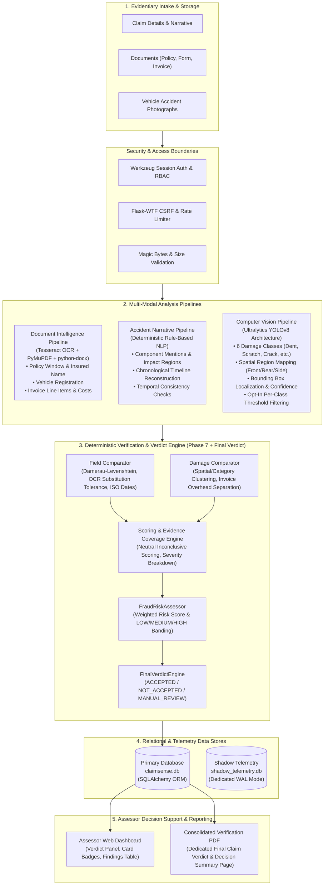

# ClaimSense AI

> **Explainable AI-Assisted Vehicle Insurance Claim Verification & Evidence Cross-Referencing Platform**
> *Academic Decision-Support Prototype &mdash; Final-Year B.Tech Major Project (Session 2026–2027)*

[](https://www.python.org/)
[-black?logo=flask)](https://flask.palletsprojects.com/)
[](https://www.sqlalchemy.org/)
[](https://www.sqlite.org/)
[](https://github.com/ultralytics/ultralytics)
[](https://pytorch.org/)
[-brightgreen)](tests/)
[](#-project-status--model-governance)

---

> [!CAUTION]
> ### 🛑 GOVERNANCE STATUS: RESEARCH COMPLETE — NO MODEL PROMOTION
> * **Phase 9.19 Research:** Formally closed.
> * **Phase 9.20 Research & Forensic Verification:** Completed and independently verified.
> * **Active Production Model:** `models/phase5/best.pt` remains the **only authorized production checkpoint** (SHA-256: `90d489e46ff8521edff88d522f0feffa164ac38a53b84700594c02a69e515565`).
> * **Candidate Model Status:** All experimental candidate checkpoints (`EXP20-01` through `EXP20-06`) **failed production promotion gates and are rejected for deployment**.
> * **Inference Architecture:** Per-class thresholding is implemented in `backend/services/vision/damage_detector.py` as an **opt-in, backward-compatible software feature**. Production defaults (`conf_threshold = 0.15`, `iou_threshold = 0.45`) remain unmodified.
> * **Next Milestone:** Phase 9.21 is proposed as the next research iteration; it has **not started**.

---

> [!IMPORTANT]
> **Academic Scope & Responsible AI Disclaimer:**
> ClaimSense AI is engineered strictly as an **assistive decision-support prototype** for insurance claims examiners and technical evaluators. It assists human assessors by cross-referencing multi-source evidentiary artifacts (official policy schedules, claim submission forms, repair invoices, claimant accident narratives, and vehicle photographs).
> **ClaimSense AI does NOT autonomously approve, adjust, or deny claims, nor does it assert legal proof of insurance fraud.** All algorithmic findings, damage classifications, and consistency scores require human assessor review and validation.

---

## 👥 Project Team & Academic Governance

* **Institution:** ABES Engineering College, Ghaziabad
* **Department:** Department of Computer Science & Engineering
* **Academic Session:** 2026–2027
* **Faculty Supervisor:** Ms. Sonia Lamba, Assistant Professor, Department of CSE

**Project Contributors:**
1. **Ansh Gupta** &mdash; Roll No. 2300320120051
2. **Ankit Yadav** &mdash; Roll No. 2300320120048
3. **Ananya Chauhan** &mdash; Roll No. 2300320120041

---

## 📌 Project Overview

Motor vehicle insurance claim adjudication routinely requires reconciling disparate, heterogeneous, and often contradictory sources of evidence:
* **Structured Policy Records:** Policy validity windows, insured vehicle registration numbers, coverage terms, and named beneficiaries.
* **Intake Claim Forms:** First-party loss descriptions, claimed incident timestamps, location statements, and driver declarations.
* **Repair Shop Documentation:** Garage work estimates, repair invoices, replacement part descriptions, and labor line items.
* **Claimant Accident Narratives:** Free-text descriptions detailing sequence of events, points of physical impact, and claimed damages.
* **Photographic Evidence:** High-resolution vehicle photographs depicting physical impact, paint scratches, dents, and fractures.

In traditional workflows, manual cross-referencing across these silos is labor-intensive, error-prone, and susceptible to cognitive fatigue. Relying on a single automated model introduces severe brittleness: an algorithm cannot discern whether a detected dent existed before the collision or whether a repair shop billed for a bumper that the photograph proves is completely undamaged.

**ClaimSense AI** solves this challenge through an **evidence cross-referencing architecture**. Rather than trusting any single model, ClaimSense AI independently parses documents, detects visual vehicle damage via Computer Vision, reconstructs accident timelines via rule-based NLP, and submits all extracted entities to a **deterministic Cross-Source Verification Engine**. The system generates transparent, explainable consistency scores, highlights discrepancies, and compiles comprehensive audit reports for human claim assessors.

---

## 🚦 Project Status & Model Governance

### Current Status Matrix
| Component | Baseline / Reference | Current Status | Governance Classification |
| :--- | :--- | :--- | :--- |
| **Production Model Checkpoint** | `models/phase5/best.pt` | Active & Verified | **IMMUTABLE PRODUCTION BASELINE** |
| **Phase 9.19 Research Program** | 4-Workstream Plan | Concluded | **RESEARCH CLOSED** |
| **Phase 9.20 Research Experiments** | EXP20-01 to EXP20-06 | Evaluated on Virgin Suite | **REJECTED FOR PRODUCTION** |
| **Inference Architecture** | `damage_detector.py` | Per-Class Thresholding Added | **COMMITTED (Opt-In / Backward-Compatible)** |
| **Virgin Benchmark Suite** | 164-Image Multi-Source | Sealed & Locked | **CERTIFIED INDEPENDENT BENCHMARK** |
| **Phase 9.21 Proposed Scope** | Multi-Angle / Patch Tiling | Planned | **NOT STARTED** |

### Absolute Model Governance Invariants
1. **Production Checkpoint Invariant:** `models/phase5/best.pt` has an immutable SHA-256 hash of `90d489e46ff8521edff88d522f0feffa164ac38a53b84700594c02a69e515565`. It is never overwritten by experimental runs.
2. **No Automatic Model Promotion:** Candidate checkpoints cannot be promoted without formal 5-gate audit sign-off, independent benchmark evaluation, and regression test verification.
3. **Threshold Invariant:** Production default thresholds remain strictly fixed at scalar `conf_threshold = 0.15` and `iou_threshold = 0.45`.
4. **Data Isolation:** Experimental runs and artifacts are strictly isolated under `runs/` and never written to customer upload directories or production database stores.

---

## 🏛️ System Architecture



---

## 🚗 Vehicle Damage Detection Architecture

### Supported Damage Classes
The vision pipeline supports six fine-grained automotive damage categories:
1. `dent` &mdash; Surface indentations and body panel concavities.
2. `scratch` &mdash; Linear abrasions, paint scuffs, and clear-coat scrapes.
3. `crack` &mdash; Hairline fractures, fissures, and structural splits in plastic/metal bumpers.
4. `glass shatter` &mdash; Fractured or spider-webbed windshields, windows, and light clusters.
5. `lamp broken` &mdash; Cracked, shattered, or displaced headlamps, tail lamps, and indicator housings.
6. `tire flat` &mdash; Deflated, punctured, bead-separated, or blown-out tires.

### Detection, Localization & Confidence Scoring
- **Detection Head:** Ultralytics YOLOv8 architecture performing multi-class classification and bounding box regression in a single forward pass.
- **Spatial Localization:** Predicted boxes are mapped to vehicle quadrant regions (`front_left`, `front_right`, `rear_left`, `rear_right`, `center`, `roof`) for cross-source spatial corroboration against the claimant narrative.
- **Production Default Parameters:**
  - `conf_threshold = 0.15` (Scalar confidence filter)
  - `iou_threshold = 0.45` (Non-Maximum Suppression IoU threshold)

### Backward-Compatible Per-Class Threshold Architecture
Implemented in `backend/services/vision/damage_detector.py`:
- **Scalar Path (Default):** Callers passing scalar floats or ints (e.g. `conf_threshold=0.15`) execute the exact legacy inference path with zero computational overhead and identical output.
- **Dictionary Path (Opt-In):** Callers may pass granular threshold dictionaries mapping class IDs or names:
  ```python
  thresholds = {
      "dent": 0.18,
      "scratch": 0.28,
      "crack": 0.25,
      "glass shatter": 0.22,
      "lamp broken": 0.25,
      "tire flat": 0.25,
  }
  detector.detect_damage(image, conf_threshold=thresholds)
  ```
- **Fallback & Robustness:** String normalization handles `'glass shatter'`, `'glass_shatter'`, and `'glass-shatter'`. Missing classes automatically fall back to `default_fallback = 0.15`. Invalid keys raise clear `ValueError`.
- **Production Status:** Research threshold mappings are **not production defaults**; the default argument remains scalar `0.15`.

---

## 🔬 Phase 9.19 Research Summary

Phase 9.19 focused on analyzing the limits of the previous Phase 9.12–9.18 accuracy program:
1. **Benchmark Exposure & Quarantine:** Historical evaluation revealed that `datasets/CarDD_300/test/` (45 images) had been repeatedly evaluated across multiple research sessions. It was officially declared a **consumed exploratory benchmark** and strictly quarantined to prevent data leakage.
2. **Root Cause Analysis of Hairline Cracks:** Identified the fundamental receptive field and bounding box regression constraints that cause rectangular YOLOv8 heads to generate loose proposals around ultra-thin fissures, depressing intersection-over-union scores below standard matching criteria.
3. **Phase Closure:** Confirmed that further model fine-tuning required fresh, unexposed benchmark imagery and granular per-class threshold controls before any candidate could be considered for promotion.

---

## 🔬 Phase 9.20 Research & Forensic Verification Summary

Phase 9.20 executed an end-to-end research workflow spanning benchmark governance, threshold architecture implementation, six controlled GPU experiments, and independent evaluation on a newly sealed virgin benchmark suite.

### The Six Phase 9.20 Controlled GPU Experiments

| Run ID | Model Code | Training Objective & Configuration | Epochs | Peak VRAM | Status |
| :--- | :--- | :--- | :---: | :---: | :---: |
| **EXP20-01** | `P920_EXP01_loss_rebalance` | Balanced classification loss (`cls=0.85`, `box=7.5`, 640px) | 25 | 1,928.1 MB | Converged |
| **EXP20-02** | `P920_EXP02_box_refinement` | Heightened box loss (`box=8.0`, `dfl=1.8`, `cls=0.80`, 640px) | 25 | 1,940.5 MB | Converged |
| **EXP20-03** | `P920_EXP03_hires_704` | Multi-scale high resolution (`imgsz=704`, `cls=0.85`, batch=12) | 25 | 1,880.2 MB | Converged |
| **EXP20-04** | `P920_EXP04_phase5_finetune` | Fine-tuning from Phase 5 baseline checkpoint (lr0=0.001, 640px) | 20 | 1,960.0 MB | Converged |
| **EXP20-05** | `P920_EXP05_hires_finetune` | High-resolution fine-tuning from Phase 5 (`imgsz=704`, batch=8) | 20 | 1,510.4 MB | Converged |
| **EXP20-06** | `P920_EXP06_regularized` | Mixup data regularization (`mixup=0.1`, `cls=0.90`, 640px) | 25 | 1,950.0 MB | Converged |

### Independent Benchmark Evaluation (164 Virgin Images, 122 GT Instances)
Evaluated strictly at $\text{IoU} \ge 0.50$ matching criterion:

| Model Evaluated | Mode | Precision | Recall | F1 Score | False Positives | True Positives | Latency |
| :--- | :--- | :---: | :---: | :---: | :---: | :---: | :---: |
| **BASELINE_Phase5** | Fixed $\tau=0.25$ | 0.07% | 10.66% | 0.0015 | 17,488 | 13 | 271 ms |
| **BASELINE_Phase5** | Calibrated Per-Class | 0.07% | 10.66% | 0.0014 | 18,894 | 13 | 177 ms |
| **EXP20-01** | Fixed $\tau=0.25$ | 0.41% | 0.82% | 0.0054 | 245 | 1 | 166 ms |
| **EXP20-01** | Calibrated Per-Class | 0.38% | 0.82% | 0.0052 | 260 | 1 | 89 ms |
| **EXP20-03** | Fixed $\tau=0.25$ | 0.00% | 0.00% | 0.0000 | 374 | 0 | 193 ms |
| **EXP20-03** | Calibrated Per-Class | 0.00% | 0.00% | 0.0000 | 397 | 0 | 168 ms |

> [!WARNING]
> **Scientific Interpretation of Benchmark Findings:**
> 1. **Massive False-Positive Containment:** Candidate models successfully suppressed background hallucinations. EXP20-01 reduced false positives from 17,488 down to 245 (over $71\times$ reduction).
> 2. **Unacceptable Operational Recall:** Despite false-positive reduction, candidate recall on the out-of-distribution virgin suite remained critically low (0.82% for EXP01, 0.00% for EXP03).
> 3. **Geometric Localization Degradation:** EXP20-03 predicted bounding boxes that encompassed whole vehicle assemblies rather than tight damage contours, yielding average IoUs of $0.35 - 0.44$, which fell below the mandatory $\text{IoU} \ge 0.50$ threshold.
> 4. **Governance Verdict:** Because candidate models failed Gate 2 (Dent Recall Retention) and Gate 3 (F1 Score Improvement), **no candidate checkpoint is approved for production deployment**.

---

## 🔒 Benchmark Governance & Provenance

The Phase 9.20 Virgin Benchmark was staged to provide an uncompromised evaluation set:
* **Total Image Count:** 164 authentic vehicle images.
* **Ground Truth Instances:** 122 verified damage instances across all 6 classes.
* **Source Composition:**
  - 120 canonical images from `CarDD_DomainAdaptation_v1/processed`.
  - 44 dual-blind adjudicated images from `CarDD_Independent_Val_v1` (Batch 01 & 02).
* **Cryptographic Seal:** `67c582847713ff071c1c22952b2e88cc4f9c3165b61b33462d654be270764fad` ([benchmark_lock_manifest.json](runs/phase9_20/benchmark/benchmark_lock_manifest.json)).
* **Zero Leakage Verified:** Cryptographic SHA-256 cross-checks confirmed **0 collisions** with training sets (`CarDD_Expanded_v1/train`) and quarantined test sets (`CarDD_300/test`).
* **Consumed Status:** The 164 images now constitute a locked benchmark; future models may not be iteratively tuned against this set to prevent overfitting.

---

## 💻 GPU Experiment Environment

All Phase 9.20 GPU training and evaluation runs were executed on dedicated hardware with telemetry logged:
* **Host Operating System:** Microsoft Windows 11 Home Single Language (Build 26100, x86_64)
* **GPU Accelerator:** 1x NVIDIA GeForce RTX 3050 Laptop GPU (4.00 GB GDDR6, 60W TGP)
* **CUDA Driver / Runtime:** CUDA 12.8
* **Deep Learning Framework:** PyTorch `2.11.0+cu128`
* **Computer Vision Suite:** Ultralytics YOLOv8 `8.4.215`
* **Python Runtime:** Python `3.13.2` 64-bit

---

## 🧪 Testing Infrastructure & Verification

The repository maintains an automated test battery with test fixtures and defensive execution guards:

```powershell
# Run the Final Claim Verdict unit, integration, PDF, and frontend DOM tests
.\.venv\Scripts\python.exe -m pytest tests/test_final_verdict.py -v

# Run the complete computer vision regression suite
.\.venv\Scripts\python.exe -m pytest tests/test_phase5_vision.py -v

# Run the per-class threshold unit test suite
.\.venv\Scripts\python.exe -m pytest tests/test_per_class_thresholds.py -v

# Run the full repository test suite
.\.venv\Scripts\python.exe -m pytest tests/ -v
```

### Integration Validation Results (`integration/final-claim-verdict`)
Recorded from the completed Final Claim Verdict integration test execution prior to commit (static historical snapshot of that validation run):
* **Targeted Integration & Verdict Battery** (`tests/test_final_verdict.py`, `tests/test_ui_redesign.py`, `tests/test_phase7_verification.py`, `tests/test_auth.py`, `tests/test_claims.py`, `tests/test_database.py`): **76 passed, 21 subtests passed, 0 failed**.
* **Full Regression Suite** (`pytest tests/ -v` on `integration/final-claim-verdict`): **212 passed, 1 skipped, 0 failed**, with **21 subtests passed**.
* **Earlier Phase 9.20 Vision Reference Runs:**
  - `tests/test_phase5_vision.py`: **29 passed, 1 skipped, 0 failed** (*skipped:* `test_kcm0_history_and_integrity_preserved` checks for an ephemeral Phase 5 claim ID `CLM-20261116-KCM0` and calls `self.skipTest()` when absent).
  - `tests/test_per_class_thresholds.py`: **11 passed, 0 skipped, 0 failed**.

---

## ⚖️ Final Claim Verdict & Fraud Risk System

The Final Claim Verdict system operates as the closing stage of ClaimSense AI's verification workflow, converting multi-source verification outputs and fraud-risk indicators into an explainable recommendation for human assessors.

### A. Final Claim Verdict Decision Engine (`FinalVerdictEngine`)
Implemented in `backend/services/verification/verdict.py`, `FinalVerdictEngine.evaluate()` deterministically classifies each evaluated claim into exactly one of three verdicts:

| Final Verdict | Condition Summary | Manual Review Required |
| :--- | :--- | :---: |
| **`ACCEPTED`** | Mandatory documents (`POLICY_DOCUMENT`, `CLAIM_FORM`, `INVOICE`) and vehicle image are present; OCR fields exist for policy, claim form, and invoice with zero extraction errors; YOLOv8 vision analysis completed without `requires_replacement` or OpenCV heuristic fallback; `overall_status == "CONSISTENT"`; `consistency_score >= 80.0%`; `evidence_coverage_percentage >= 70.0%`; `matched_comparisons >= 3`; zero failed or inconclusive checks; and `fraud_risk_level == "LOW"`. | `False` |
| **`NOT_ACCEPTED`** | At least one critical/high cross-source contradiction (`STATUS_MISMATCH` with `CRITICAL`/`HIGH` severity, or failed critical identity fields such as Policy Number, Policy Coverage Validity, Vehicle Registration, Claimant Name, Accident Date, or Claim Amount) **or** `>= 2` failed checks. Applies **regardless of whether `fraud_risk_level` is `LOW`**. | `False` |
| **`MANUAL_REVIEW`** | Safe fallback when any required document, vehicle photo, or OCR category is missing/inconclusive; vision failed, fell back to OpenCV, or flagged image authenticity (`requires_replacement`); `consistency_score < 80.0%`, `evidence_coverage_percentage < 70.0%`, or `matched_comparisons < 3`; `overall_status != "CONSISTENT"`; a single non-critical failed check occurs; or `fraud_risk_level` is `MEDIUM` or `HIGH` **without** established hard contradictions (claims are never auto-rejected on risk score alone). | `True` |

### B. Fraud Risk Assessment (`FraudRiskAssessor`)
Implemented in `backend/services/risk/assessor.py` (`FraudRiskAssessor.assess()`), the risk engine computes a bounded numeric risk score (`0.0`–`100.0`) and persists a `RiskAssessment` row in `risk_assessments` using thresholds from `backend/config.py` / `.env`:
* **Configured Default Thresholds:** `RISK_THRESHOLD_LOW=30`, `RISK_THRESHOLD_MEDIUM=60`:
  * `LOW`: `risk_score < 30`
  * `MEDIUM`: `30 <= risk_score < 60`
  * `HIGH`: `risk_score >= 60`
* **Additive Scoring Signals:**
  * Direct mismatches (`STATUS_MISMATCH`): `+35` (`CRITICAL`), `+20` (`HIGH`), `+12` (other severities)
  * Potential discrepancies (`STATUS_POTENTIAL_DISCREPANCY`): `+20` (`CRITICAL`/`HIGH`), `+10` (other)
  * Visual-only detections omitted from claimant narrative: `+5` per finding (capped at `20`)
  * Claimed damage items not visually confirmed: `+5` per finding (capped at `15`)
  * Synthetic/invalid vehicle image flagged (`requires_replacement`): `+25`
  * Ambiguity / missing evidence indicators (`missing_evidence_count > 0`, `inconclusive_count > 0`, `cv_unevaluated_count > 0`): `+5` each (capped at `15`)
  * Unavailable extraction and comparison inputs (empty OCR rows and findings): `+10`

### C. Database Schema & Backward-Compatible Migrations
Five nullable verdict columns are added to the `claims` table (`backend/database/models.py`) and applied automatically via idempotent `ALTER TABLE` statements in `_ensure_schema_migrations()` (`backend/database/db.py`):
* `final_verdict` (`VARCHAR(32)`, indexed) &mdash; `ACCEPTED`, `NOT_ACCEPTED`, `MANUAL_REVIEW`, or `NULL`
* `decision_reason` (`TEXT`) &mdash; human-readable explanation of the decision and triggering checks
* `fraud_risk_level` (`VARCHAR(32)`) &mdash; `LOW`, `MEDIUM`, `HIGH`, or `NULL`
* `decision_timestamp` (`DATETIME`) &mdash; UTC timestamp of the verdict evaluation
* `verdict_details` (`TEXT`) &mdash; serialized JSON storing `fraud_risk_score`, `verification_summary`, `passed_checks`, `failed_checks`, `inconclusive_checks`, `manual_review_required`, `manual_review_remarks`, `risk_reasons`, and `decision_timestamp`

Legacy claim records with `final_verdict = NULL` remain untouched in SQLite and serialize safely (`"final_verdict": null`, `"verdict": null`) across lookup APIs and PDF generators. When verification runs on an older verified claim without a persisted verdict, `ClaimVerificationService.evaluate_and_persist_verdict()` backfills the verdict non-destructively.

### D. Final Verdict & Verification API Endpoints (`backend/routes/claims.py`)

| Endpoint | Method | Purpose & Payload Notes |
| :--- | :---: | :--- |
| `/api/claims/<claim_id>/verdict` | `GET` | Retrieves persisted verdict for authenticated owner/assessor/admin. Returns `success`, `claim_id`, `has_verdict` (`true`/`false`), `final_verdict`, and `verdict` (`null` for legacy unverified claims). |
| `/api/claims/<claim_id>/verdict` | `POST` | Runs or refreshes verification + fraud risk + verdict evaluation (`{"force": true}` default). Returns `success`, `claim_id`, `has_verdict`, `final_verdict`, `verdict`, and `verification`. |
| `/api/claims/<claim_id>/verify-cross-source` | `POST` | Runs Phase 7 cross-source verification, `FraudRiskAssessor`, and `FinalVerdictEngine`, persisting all outputs and returning `verification` + `verdict`. |
| `/api/claims/<claim_id>/verification` | `GET` | Returns latest verification run (`verification`) along with `verdict`. |
| `/api/claims/<claim_id>/verification/summary` | `GET` | Returns summary verification counters plus `verdict` and `final_verdict`. |
| `/api/claims` (`?auto_verify=true`) | `POST` | Optional query flag runs immediate verdict evaluation after intake persistence and returns `verdict` and `final_verdict`. |
| `/api/claims/<claim_id>`, `/api/claims/policy/<policy_number>`, `/api/claims/search`, `/api/my-claims` | `GET` | Serialized claim records include `final_verdict`, `decision_reason`, `fraud_risk_level`, `decision_timestamp`, and structured `verdict`. |
| `/api/claims/<claim_id>/receipt` (`?format=json` / PDF) | `GET` | JSON receipt includes `final_verdict` (full verdict dict or `null`); PDF receipt renders verdict summary when evaluated. |
| `/api/claims/<claim_id>/document-report` (alias `/report`) | `GET` | Backfills verdict if `verification_runs` exist without `final_verdict` and serves the Complete Claim Verification PDF with the dedicated verdict page. |

Example `GET /api/claims/<claim_id>/verdict` response:
```json
{
  "success": true,
  "claim_id": "CLM-20261127-WT04",
  "has_verdict": true,
  "final_verdict": "MANUAL_REVIEW",
  "verdict": {
    "final_verdict": "MANUAL_REVIEW",
    "decision_reason": "Claim routed to MANUAL_REVIEW because automated evidence is incomplete...",
    "fraud_risk_level": "MEDIUM",
    "fraud_risk_score": 30.0,
    "verification_summary": {
      "overall_status": "REVIEW_REQUIRED",
      "consistency_score": 66.9,
      "evidence_coverage_percentage": 75.0,
      "total_comparisons": 20,
      "matched_comparisons": 3,
      "mismatched_comparisons": 0,
      "missing_evidence_count": 4,
      "inconclusive_count": 1
    },
    "passed_checks": [...],
    "failed_checks": [],
    "inconclusive_checks": [...],
    "manual_review_required": true,
    "manual_review_remarks": [...],
    "risk_reasons": [...],
    "decision_timestamp": "2026-11-27T12:51:08.452301"
  }
}
```

### E. Frontend UI Integration (`frontend/index.html`, `frontend/style.css`, `frontend/app.js`)
* **Modal Header Verdict Badge:** `#modal-header-verdict-badge` beside `#modal-details-id` displays the live status (`ACCEPTED`, `NOT ACCEPTED`, `MANUAL REVIEW`, or `PENDING`).
* **Top-of-Modal Final Claim Verdict Panel (`#final-verdict-panel`):** Displayed at the top of `#modal-claim-details` with color-coded status styling (green/red/amber/neutral), `fraud_risk_level` + numeric risk score badge, **Decision Rationale**, verification summary chips (`Score`, `Checks`, `Passed`, `Failed`, `Inconclusive`), itemized **Passed Checks**, **Failed Checks & Contradictions**, and **Inconclusive / Missing Evidence** lists, **Manual Review Guidance** box when applicable, and localized **Decision Timestamp**.
* **Claim Cards (`renderClaimCard`):** Both **My Submissions** and **Policy Claim Lookup** render compact Final Claim Verdict badges directly in card headers and append cache-busting timestamps to report download links after re-verification.

### F. PDF & Receipt Reports (`backend/services/receipt.py`)
* **Complete Claim Verification PDF (`generate_document_intelligence_report_pdf`):** When a claim has an evaluated verdict, renders a dedicated page titled **`Page X: Final Claim Verdict and Decision Summary`** (`Page 8` following Phase 7 `Page 7`, moving processing errors/disclaimer to `Page 9`) containing:
  * Color-coded `FINAL CLAIM VERDICT` and `FRAUD RISK` summary banner
  * `Final Verdict`, `Fraud Risk Level & Score`, `Decision Reason`, `Verification Summary`, `Decision Timestamp`, and `Manual Review Remarks` (when present)
  * Structured tables for `Passed Checks`, `Failed Checks`, and `Inconclusive Checks`
* **Submission Receipt PDF (`generate_claim_receipt_pdf`):** Includes a `3. Final Claim Verdict Decision Summary` table (`Final Verdict`, `Decision Reason`, and `Review Remarks` when present) whenever the claim has a persisted verdict, while preserving legacy receipts when `verdict` is `None`.

---

## 🗃️ Datasets & Multi-Modal Roles

ClaimSense AI uses specialized datasets for distinct functional subsystems:
1. **CarDD (Damage Detection):** Vehicle damage bounding boxes across 6 categories (`dent`, `scratch`, `crack`, `glass shatter`, `lamp broken`, `tire flat`). Used exclusively for YOLOv8 training and evaluation.
2. **FUNSD (Form Understanding):** Academic dataset for scanned document understanding, key-value pair extraction, and layout intelligence. Used for document pipeline architecture reference.
3. **SROIE (Receipt OCR):** Academic dataset for invoice and receipt optical character recognition. Used for repair bill entity extraction evaluation.

> [!NOTE]
> Neither FUNSD nor SROIE contain vehicle damage photographs. Vehicle damage detection models are trained solely on CarDD automotive imagery.

---

## 📁 Repository Structure

```text
ClaimSense-AI/
├── backend/                               # Core backend application
│   ├── app.py                             # Flask application factory
│   ├── config.py                          # Environment configuration
│   ├── database/                          # Persistence layer
│   │   ├── db.py                          # Engine lifecycle & idempotent schema migrations
│   │   ├── models.py                      # SQLAlchemy ORM models (incl. Claim verdict fields)
│   │   └── claimsense.db                  # [Local] Primary SQLite production database
│   ├── routes/                            # REST API blueprints (auth, claims, health)
│   └── services/                          # Domain services
│       ├── ocr/                           # Document intelligence & OCR
│       ├── nlp/                           # Rule-based narrative & timeline analysis
│       ├── risk/                          # Weighted fraud-risk assessment
│       │   └── assessor.py                # Deterministic FraudRiskAssessor
│       ├── verification/                  # Cross-Source Verification & Final Verdict engine
│       │   ├── service.py                 # Verification + risk + verdict orchestrator
│       │   └── verdict.py                 # FinalVerdictEngine decision rules
│       ├── receipt.py                     # Submission receipts & Complete Verification PDFs
│       └── vision/                        # Damage detection & threshold resolution
│           ├── damage_detector.py         # YOLOv8 detector with per-class threshold support
│           └── shadow_worker.py           # Hardened shadow trial worker
├── datasets/                              # Dataset roots (excluded from git)
│   └── phase9_20_benchmark/               # Locked 164-image independent virgin benchmark
│       ├── images/                        # 164 benchmark images
│       └── labels/                        # 122 ground-truth YOLO labels
├── frontend/                              # Responsive assessor web application
│   ├── index.html                         # Assessor dashboard
│   ├── app.js                             # Frontend application controller
│   └── style.css                          # Modern responsive styling
├── models/                                # Production model checkpoints
│   └── phase5/
│       └── best.pt                        # Authoritative production checkpoint (SHA-256: 90d489e46...)
├── reports/                               # Generated verification PDFs and intake receipts
├── runs/                                  # Research experiments and audit reports
│   ├── phase9_20/                         # Phase 9.20 research and forensic artifacts
│   │   ├── architecture/                  # Per-class threshold design & compatibility reports
│   │   ├── benchmark/                     # Lock manifest & provenance records
│   │   ├── checkpoints/                   # Checkpoints for EXP01–EXP06 (symlinked)
│   │   ├── evaluations/                   # Virgin benchmark & validation matrices (JSON)
│   │   ├── forensic_verification/         # 7 formal forensic audit deliverables
│   │   └── reports/                       # Master Phase 9.20 reports
│   └── ml_accuracy_program_final_report.md# Master ML accuracy program report
├── scripts/                               # Operational & evaluation CLI tools
├── tests/                                 # Automated test suite
│   ├── test_final_verdict.py              # Final Claim Verdict, Risk & PDF/UI integration tests
│   ├── test_per_class_thresholds.py       # Per-class threshold architecture unit tests
│   ├── test_phase5_vision.py              # Computer vision regression suite
│   └── test_e2e.py                        # Master E2E integration test suite
├── .env.example                           # Configuration template
├── requirements.txt                       # Python dependencies
└── README.md                              # Master project documentation
```

---

## 🛠️ Installation, Setup & Execution

### System Prerequisites
* **Operating System:** Windows 10/11, Ubuntu 20.04+, or macOS.
* **Python Runtime:** Python 3.10 to Python 3.13 (Verified on Python 3.13.2).
* **Git:** Version control client.
* **GPU (Optional):** NVIDIA GPU with CUDA 11.8+ / 12.8+ for accelerated inference.

### 1. Setup & Environment
```powershell
# Clone the repository
git clone https://github.com/anshg8252/ClaimSense-AI.git
cd ClaimSense-AI

# Create virtual environment
python -m venv .venv
.\.venv\Scripts\Activate.ps1

# Install package dependencies
pip install --upgrade pip
pip install -r requirements.txt
```

### 2. Configure Environment
```powershell
Copy-Item .env.example .env
```

### 3. Launch the Application
```powershell
.\.venv\Scripts\python.exe backend/app.py
```
Open `http://127.0.0.1:5000/` in any modern web browser to access the assessor dashboard (default `HOST=127.0.0.1`, `PORT=5000` in `.env.example`; `.env` configures runtime overrides such as `DATABASE_PATH`).

---

## 🗺️ Project Roadmap

| Phase | Milestone Name | Status | Summary |
| :---: | :--- | :---: | :--- |
| **Phase 1–6** | Foundations, DB, OCR, Vision, NLP | **Completed** | Full multi-modal claim ingestion and processing pipelines. |
| **Phase 7** | Cross-Source Verification | **Completed** | Deterministic consistency engine and consolidated verification PDF reports. |
| **Final Verdict** | Risk Scoring & Final Claim Verdict | **Integrated** | Deterministic `FraudRiskAssessor`, `FinalVerdictEngine` (`ACCEPTED`/`NOT_ACCEPTED`/`MANUAL_REVIEW`), DB migrations, APIs, UI panel, and dedicated PDF verdict page. |
| **Phase 8** | Dataset Preparation & Gate P | **Closed at Gate P** | Multi-tier datasets, dual-blind annotation, offline safety hardening. |
| **Phase 9.12–9.18** | ML Accuracy Program | **Completed & Closed** | Crack forensics, CarDD retraining, Gate 5 scorecard, baseline retained. |
| **Phase 9.19** | Pre-Start Readiness & Closure | **Completed & Closed** | Quarantine boundary confirmed, CarDD_300/test sealed as consumed. |
| **Phase 9.20** | Advanced Detection & Forensic Audit | **Completed & Verified** | Per-class thresholding implemented; EXP01–06 evaluated; no model promotion. |
| **Phase 9.21** | Patch Tiling & Polygon Segmentation | **Proposed / Planned** | Proposed next phase: SAHI inference tiling and polygon instance segmentation. Not started. |

---

## 📚 Key Phase 9.20 Research & Forensic Reports

All Phase 9.20 engineering and governance deliverables are maintained directly in the repository:

* **Forensic Verification Deliverables (`runs/phase9_20/forensic_verification/`):**
  * [Master Forensic Verification Report](runs/phase9_20/forensic_verification/phase9_20_forensic_verification.md) &mdash; Comprehensive forensic report across all 6 GPU runs, benchmarks, and production safety invariants.
  * [Training Completion Audit Table](runs/phase9_20/forensic_verification/training_completion_audit.csv) &mdash; Per-experiment hardware telemetry, loss convergence, epoch counts, and hashes.
  * [Benchmark Metric Reconciliation Table](runs/phase9_20/forensic_verification/benchmark_metric_reconciliation.csv) &mdash; 140-row independent metric reconciliation across validation and virgin suites.
  * [Benchmark Provenance & Zero-Leakage Audit](runs/phase9_20/forensic_verification/benchmark_provenance_verification.md) &mdash; 164-image source lineage, hash verification, and quarantine enforcement.
  * [Production Code & Asset Safety Audit](runs/phase9_20/forensic_verification/production_code_safety_audit.md) &mdash; Byte-exact verification of `best.pt`, `claimsense.db`, and `damage_detector.py` diff.
  * [Test Execution Reconciliation Report](runs/phase9_20/forensic_verification/test_execution_reconciliation.md) &mdash; Complete reconciliation of test collection and skipped test analysis.
  * [Final Model Governance Decision](runs/phase9_20/forensic_verification/final_governance_decision.md) &mdash; Formal 5-gate audit sign-off: *VERIFIED — RESEARCH COMPLETE, NO PROMOTION*.

* **Phase 9.20 Stage Reports (`runs/phase9_20/`):**
  * [Phase 9.20 Final Execution Report](runs/phase9_20/reports/phase9_20_final_report.md) &mdash; Master report summarizing Stages 1 through 4 execution.
  * [Per-Class Threshold Architecture Design](runs/phase9_20/architecture/per_class_threshold_design.md) &mdash; Software architecture and backward-compatibility specification.
  * [Dent Recall Regression Hypotheses](runs/phase9_20/reports/dent_recall_regression_hypotheses.md) &mdash; Root-cause analysis of IoU matching and domain shift dynamics.
  * [False-Positive Reduction Strategy](runs/phase9_20/reports/false_positive_reduction_strategy.md) &mdash; Background negative mining and activation barrier analysis.

---

## 📄 License & Academic Attribution

This project is developed as a **Final-Year B.Tech Major Project** within the Department of Computer Science & Engineering at **ABES Engineering College, Ghaziabad**.
* Maintained strictly for educational evaluation and research purposes.
* Third-party research datasets (CarDD, FUNSD, SROIE) remain the intellectual property of their respective academic creators and are governed by their original licenses.
