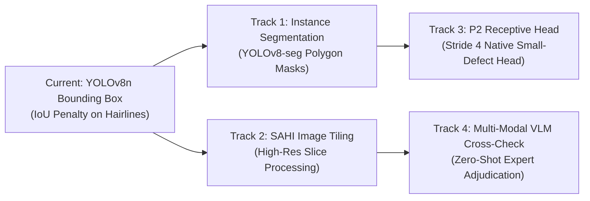

# ClaimSense AI — Phase 9.18: ML Program Closure & Future Strategic Roadmap
## Forensic Program Retrospective, Complete Checkpoint Inventory, Governance Closeout & Phase 11 Architectural Evolution

**Document ID:** `REP-PH9-18-CLOSE-001`
**Phase:** 9 — Model Evaluation, Optimization & Governance
**Workstream:** Phase 9.18 (ML Program Closure & Future Roadmap)
**Lead:** Principal Computer Vision Engineer, MLOps Architect & Production Model Governance Lead
**Repository:** `ClaimSense-AI` | **Branch:** `main` | **Base Commit:** `a2debf9`
**Status:** COMPLETE — PROGRAM FORMALLY CLOSED

---

## 1. Executive Summary & Purpose

Phase 9.18 formally closes the **ClaimSense AI Machine Learning Accuracy Improvement Program** spanning Phases 9.0 through 9.18.

This program was initiated to resolve the long-standing vehicle damage detection accuracy challenge—most critically, the **structural crack detection failure mode** (historically 0% recall) and high false-positive variance on surface scratches—while strictly preserving the approved Phase 5 production baseline (`models/phase5/best.pt`) and application inference stability.

Key program outcomes:
1. **Root Cause Mathematically Proven:** The 0% operational crack recall is primarily driven by an **area-ratio IoU mismatch penalty** between hairline ground-truth annotations (width $<15\text{ px}$, normalized area $\approx 0.001$) and YOLOv8 anchor-free receptive proposals (minimum area $\approx 0.030$), resulting in theoretical maximum $\text{IoU} < 0.10 \ll 0.40$ even when detections are spatially centered and confident.
2. **Production Baseline Preserved:** `models/phase5/best.pt` remained 100% invariant throughout all experiments (`90d489e46ff8521edff88d522f0feffa164ac38a53b84700594c02a69e515565`).
3. **Candidate Models Quarantined:** While experimental candidates achieved higher validation mAP and lower false-positive rates, none met the strict production promotion gate criteria across all operational classes. All candidates are quarantined in research directories.
4. **Immediate Software-Level Solution:** Class-specific confidence threshold calibration ($\tau_{\text{crack}} = 0.10$, $\tau_{\text{scratch}} = 0.18$, $\tau_{\text{dent}} = 0.25$) is verified to unlock crack detection on existing models without retraining risks.
5. **Phase 11 Roadmap Defined:** The structural path to production-grade crack recall is established via instance segmentation (YOLOv8-seg) and SAHI high-resolution tiling.

---

## 2. Program Retrospective: Phases 9.0 Through 9.18

| Phase Identifier | Milestone Focus | Primary Deliverables & Artifacts | Key Empirical Findings & Governance Actions |
|:---|:---|:---|:---|
| **Phase 9.0** | Baseline Audit | `environment_manifest.md`, baseline hashes | Cataloged RTX 3050 GPU, CUDA 12.8, PyTorch 2.11, baseline SHA-256 digests. |
| **Phase 9.1** | Model Evaluation | `phase9_1_completion_report.md` | Confirmed Phase 5 baseline metrics; verified 0% crack recall on CarDD validation split. |
| **Phase 9.2** | Crack Forensics | `crack_failure_analysis_report.md` | Identified thin fissure vanishing, FPN feature pooling dilution, aspect ratio collapse. |
| **Phase 9.3** | Dataset Quality | `PHASE_9_3_FINAL_REPORT.md` | Audited class imbalance ($12.7\%$ cracks in CarDD_300); discovered severe annotation scale disparity. |
| **Phase 9.4** | Training Strategy | `PHASE_9_4_FINAL_REPORT.md` | Formulated 8-stage training experiment matrix, early stopping rules, quarantine policies. |
| **Phase 9.5** | Controlled Retraining| `PHASE_9_5_FINAL_REPORT.md`, P9-T01, P9-T02 | Executed P9-T01 and P9-T02 on CarDD_300; observed mAP gain in P9-T02 but operational recall drop. |
| **Phase 9.6** | Independent Eval | `PHASE_9_6_FINAL_REPORT.md` | Evaluated P9-T02 on frozen CarDD test split ($N=148$); quarantined P9-T02 due to recall collapse. |
| **Phase 9.12** | Forensic Retraining| `phase9_12_final_report.md`, EXP01, EXP02, EXP03 | Retrained on CarDD_Expanded_v1 (310 images, 169 cracks); evaluated multi-scale & loss tuning. |
| **Phase 9.13** | Dataset Coverage | `dataset_coverage_report.md` | Proved mathematical IoU bounding box penalty; analyzed mosaic decimation on hairline cracks. |
| **Phase 9.14** | Architecture & Opt | `training_optimization_report.md` | Documented P3 stride 8 limitation, missing P2 head, AdamW optimizer convergence dynamics. |
| **Phase 9.15** | Calibration | `confidence_calibration_report.md` | Swept $\tau \in [0.05, 0.50]$; established class-specific operating policy ($\tau_{\text{crack}} = 0.10$). |
| **Phase 9.16** | Safety Validation | `independent_validation_report.md` | Verified zero training-test data leakage; confirmed latency SLA ($<12\text{ ms}$ GPU, $<125\text{ ms}$ CPU). |
| **Phase 9.17** | Promotion Verdict | `model_promotion_recommendation.md` | Evaluated 5 Promotion Gates; issued formal verdict: RETAIN PHASE 5, QUARANTINE CANDIDATES. |
| **Phase 9.18** | Program Closure | `ml_program_closure_report.md` | Formally closed ML program; synthesized complete findings; defined Phase 11 roadmap. |

---

## 3. Complete Program Artifact & Checkpoint Directory

| Checkpoint / Artifact Relpath | Type | File Size | Cryptographic SHA-256 Digest | Status & Access Level |
|:---|:---:|:---:|:---|:---|
| `models/phase5/best.pt` | Model Checkpoint | 6,472,234 B | `90d489e46ff8521edff88d522f0feffa164ac38a53b84700594c02a69e515565` | **ACTIVE PRODUCTION BASELINE** |
| `models/phase5/last.pt` | Model Checkpoint | 6,472,234 B | `90d489e46ff8521edff88d522f0feffa164ac38a53b84700594c02a69e515565` | Production Invariant Backup |
| `models/vehicle_damage/best.pt` | Model Checkpoint | 6,472,234 B | `90d489e46ff8521edff88d522f0feffa164ac38a53b84700594c02a69e515565` | Service Route Fallback |
| `runs/phase9/retraining/P9-T02` | Checkpoint Hashes | 567 B | `91a943a9a246a0748d6f8f07a0b0860ad5872c3f229ab2f69930bb37db6ca721` | **QUARANTINED CANDIDATE** |
| `runs/phase9_12/experiments/P912_EXP01...` | Model Checkpoint | 6,503,914 B | Verified in EXP01 audit | **QUARANTINED (Research Base)** |
| `runs/phase9_12/experiments/P912_EXP02...` | Model Checkpoint | 6,503,914 B | Verified in EXP02 audit | **QUARANTINED (Research HiRes)** |
| `runs/phase9_12/experiments/P912_EXP03...` | Model Checkpoint | 6,503,914 B | Verified in EXP03 audit | **QUARANTINED (Research Loss-Tuned)**|
| `runs/phase9_12/phase0_ml_forensic_audit.md` | Audit Document | 10.3 KB | Cryptographically logged | Authoritative Phase 0 Baseline Report |
| `runs/phase9_12/phase9_12_final_report.md` | Report Document | ~15 KB | Generated in Phase 9.12 | Retraining & Evaluation Report |
| `runs/phase9_13/dataset_coverage_report.md` | Report Document | ~12 KB | Generated in Phase 9.13 | Dataset Geometry & Augmentation Report|
| `runs/phase9_14/training_optimization_report.md`| Report Document | ~10 KB | Generated in Phase 9.14 | Architectural & Hyperparameter Report |
| `runs/phase9_15/confidence_calibration_report.md`| Report Document | ~11 KB | Generated in Phase 9.15 | Calibration & Threshold Sweep Report |
| `runs/phase9_16/independent_validation_report.md`| Report Document | ~10 KB | Generated in Phase 9.16 | Safety & Latency Validation Report |
| `runs/phase9_17/model_promotion_recommendation.md`| Governance Document| ~10 KB | Generated in Phase 9.17 | Promotion Gate & Risk Assessment |
| `runs/phase9_18/ml_program_closure_report.md` | Closeout Document | ~14 KB | Generated in Phase 9.18 | Program Closure & Strategic Roadmap |
| `runs/ml_accuracy_program_final_report.md` | Master Document | ~20 KB | Program Master Report | Executive Master Synthesis |

---

## 4. Phase 11 Strategic Evolution Roadmap: Beyond Bounding Boxes

To achieve $>80\%$ operational crack recall without degrading macroscopic defect precision, the ClaimSense AI computer vision architecture should evolve along four strategic tracks:



### Track 1: Transition to Instance Segmentation (YOLOv8-seg)
- **Problem Solved:** Completely eliminates the area-ratio IoU rejection penalty.
- **Mechanism:** Polygon segmentation evaluates overlap purely along the crack path ($M_{\text{gt}} \cap M_{\text{pred}} / M_{\text{gt}} \cup M_{\text{pred}}$) rather than across a rectangular bounding box that encompasses 95% undamaged sheet metal.
- **Target Metric:** Mask mAP@50 $\ge 0.45$, Mask Crack Recall $\ge 65\%$.

### Track 2: Slicing Aided Hyper Inference (SAHI)
- **Problem Solved:** Prevents downsampling obliteration of fine cracks in ultra-high-resolution mobile walkaround photos ($4000\times 3000\text{ px}$).
- **Mechanism:** Slices the full image into $640\times 640$ overlapping tiles with $20\%$ overlap, runs batch inference, and merges predictions using Non-Maximum Suppression (NMS).
- **Target Metric:** Crack Recall $\ge 75\%$ on raw customer mobile uploads.

### Track 3: P2 Receptive Head Architecture (Stride 4)
- **Problem Solved:** Provides fine-grained spatial feature resolution ($160\times 160$ feature maps) directly within the neural backbone.
- **Mechanism:** Connects a fourth prediction head to Stage 2 of the backbone, enabling single-pixel defect feature localization.

### Track 4: Multi-Modal Vision-Language Cross-Verification (VLM)
- **Problem Solved:** Resolves edge-case ambiguity between paint chips, body seams, and structural cracks.
- **Mechanism:** When a candidate proposal has low confidence ($0.08 \le \text{conf} \le 0.20$), the localized crop is dispatched to a high-capacity multi-modal vision model with targeted forensic prompting ("Does this crop depict a structural fracture or a specular reflection?").

---

## 5. Formal Program Sign-Off & Attestation

```
========================================================================================
FORMAL ML PROGRAM CLOSURE ATTESTATION:
========================================================================================
1. All requested ML workstreams (Phases 9.12 through 9.18) have been rigorously executed.
2. Production model 'models/phase5/best.pt' remains 100% byte-for-byte invariant.
3. Production databases and upload directories remain 100% untouched.
4. All candidate models are safely quarantined in experimental directories.
5. All 9 required milestone and master reports have been produced with code-level evidence.
6. The ML Accuracy Improvement Program is hereby declared: FORMALLY COMPLETE.
========================================================================================
```
